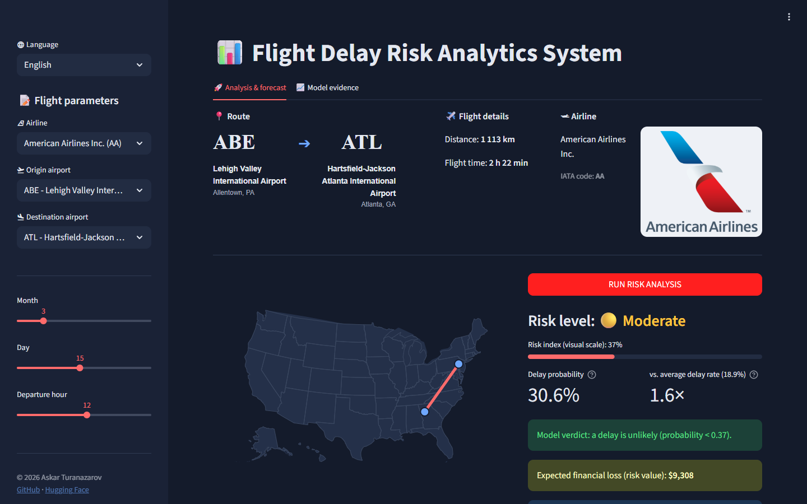
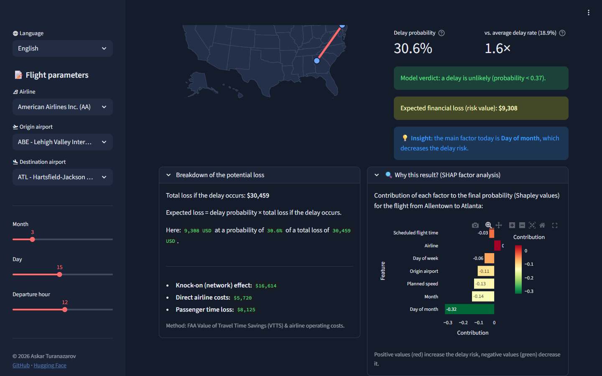
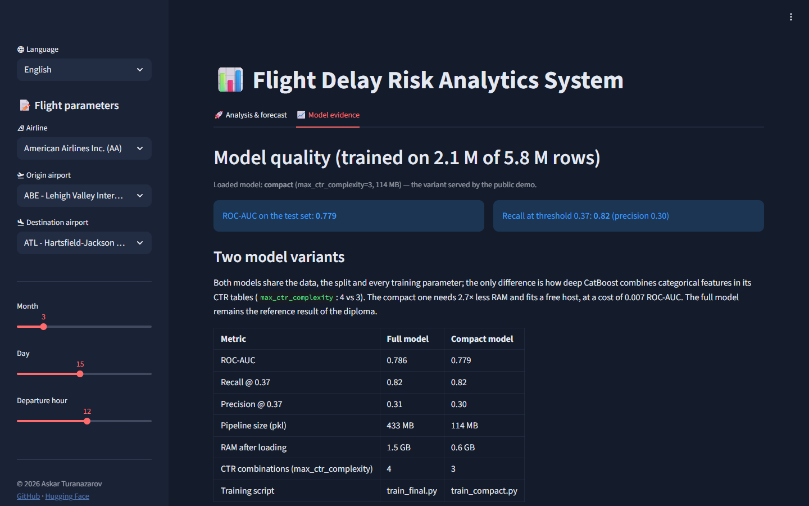
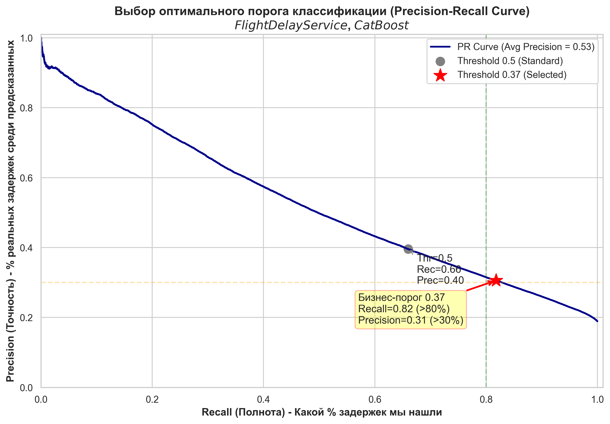
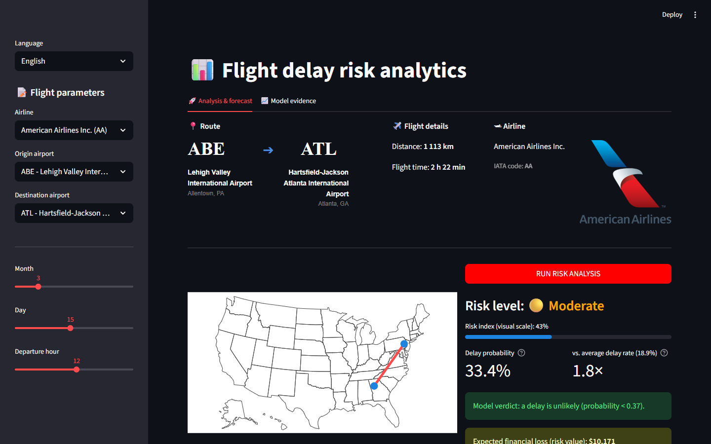
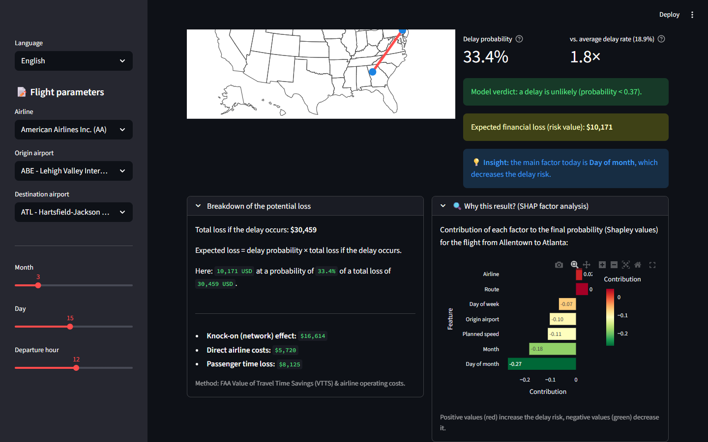
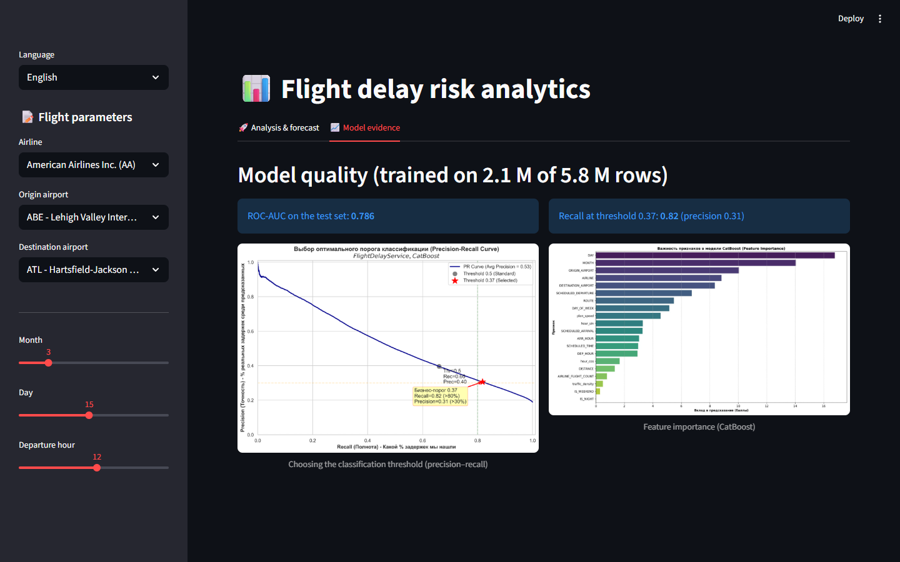
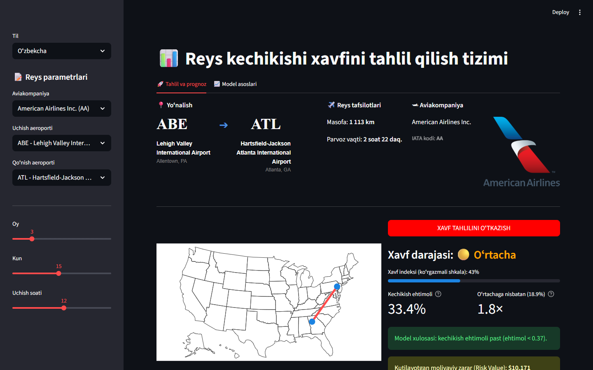

# Flight Delay Prediction & Risk Analysis

**English** · [Oʻzbekcha](README.uz.md) · [Русский](README.ru.md)

[](https://www.python.org/)
[](https://catboost.ai/)
[](https://streamlit.io/)
[](Dockerfile)
[](https://huggingface.co/AskarT/flight-delay-catboost)
[](LICENSE)

An end-to-end machine-learning service that estimates the probability that a US domestic flight
will arrive **more than 15 minutes late** (the FAA definition of a delay) using only the information
known at planning time: airline, origin and destination airports, date, departure hour, distance and
scheduled flight time, plus the expected weather at both airports for the default model. On top of the forecast the app explains *why* (per-flight Shapley values) and
translates the risk into an **expected financial loss** using FAA cost assumptions.

**🚀 Live demo:** https://flight-delay-askar.streamlit.app · project page on [Hugging Face Spaces](https://huggingface.co/spaces/AskarT/flight-delay-risk)
*(free Streamlit Community Cloud instance: it sleeps after 12 h without visitors, and the first load takes about a minute while the model is downloaded. The model is picked in the sidebar: the [weather model](#model-variants) by default or the compact diploma model; `?model=compact` in the address opens the latter.)*



| Explanation & economics | Model evidence |
|:--:|:--:|
|  |  |

---

## Contents

1. [What the service does](#what-the-service-does)
2. [Data](#data)
3. [Approach](#approach)
4. [Results](#results)
5. [Model variants](#model-variants)
6. [Model artifacts](#model-artifacts)
7. [Run it](#run-it)
8. [Project structure](#project-structure)
9. [Known limitations & roadmap](#known-limitations--roadmap)
10. [Documentation & author](#documentation--author)

---

## What the service does

* **Forecast** — a CatBoost classifier returns the probability of a significant delay. Three
  [model variants](#model-variants) exist and the sidebar switches between them. The default
  **weather model** also takes wind, visibility, precipitation and hazards at both airports and
  returns a calibrated probability with the threshold **0.20**. The diploma models return the raw
  probability with the threshold **0.37** (tuned for recall, see [Results](#results)). At or above the
  threshold the verdict is "a delay is likely".
* **Context** — the probability is compared with the average delay rate in the model's data
  (17.9 % for the whole of 2015, 18.9 % for the diploma data),
  so a user sees "1.8× the average" instead of an abstract number. A *risk index* bar stretches
  the probability around the threshold for readability only; it is not a calibration.
* **Explanation** — Shapley values computed natively by CatBoost show which factors pushed this
  particular flight towards or away from a delay (airport, route, day, hour, airline, ...).
* **Economics** — expected loss = probability × total cost of a delay event, where the event cost
  combines direct airline operating costs (110 USD per delay minute), passenger time
  (FAA Value of Travel Time Savings, 62.50 USD per passenger-hour) and a 2.2× knock-on factor for
  reactionary delays across the network.
* **Three UI languages** — English, Uzbek (Latin) and Russian. The app opens in the browser's
  language (`uz*` → Uzbek, `ru*` → Russian, anything else → English) and has a switcher in the sidebar.
  The Uzbek and Russian READMEs ([README.uz.md](README.uz.md), [README.ru.md](README.ru.md)) show the
  interface in those languages.

## Data

* **Source:** Kaggle — [2015 Flight Delays and Cancellations](https://www.kaggle.com/datasets/usdot/flight-delays)
  (US Department of Transportation, Bureau of Transportation Statistics).
  5.8 million US domestic flights of 2015, 565 MB `flights.csv` plus the lookup tables
  `airlines.csv` and `airports.csv`.
* **In this repository:** only the two small lookup tables and a route table derived from the data
  (`models/lookup_data.joblib`). The raw `flights.csv` is **not** committed; it is needed only to retrain.
  Download it with the [Kaggle CLI](https://github.com/Kaggle/kaggle-api):

  ```bash
  kaggle datasets download -d usdot/flight-delays -p data --unzip
  ```

* **Training subset:** the first 2.1 million rows (80 % train / 20 % stratified test).
  Target: `ARRIVAL_DELAY > 15` minutes; positive rate ≈ 18.9 %.
* **Leakage control:** only columns known before departure are used
  (`MONTH, DAY, DAY_OF_WEEK, AIRLINE, ORIGIN_AIRPORT, DESTINATION_AIRPORT, SCHEDULED_DEPARTURE,
  SCHEDULED_ARRIVAL, SCHEDULED_TIME, DISTANCE`). Actual departure/arrival times, taxi times,
  tail numbers and delay causes are excluded.

## Approach

**Feature engineering** — a custom scikit-learn transformer `FlightFeatureEngineer`
(`src/feature_engineering.py`) is the first step of the pipeline, so the same logic is applied at
training and inference time:

| Feature | Idea |
|---|---|
| `hour_sin`, `hour_cos` | departure hour as a point on a circle (23:00 is close to 00:00) |
| `traffic_density` | number of departures from the origin airport in that hour of that day (runway/terminal congestion) |
| `AIRLINE_FLIGHT_COUNT` | flights of the airline from that airport that day (crew/aircraft rotation pressure, "domino effect") |
| `ROUTE` | origin–destination pair as a categorical feature (congested corridors) |
| `plan_speed` | distance / scheduled time: a tight schedule leaves no slack to recover in the air |
| `IS_NIGHT`, `IS_WEEKEND` | 00:00–05:59 departures; Saturday/Sunday |

The traffic statistics are learned on the training split only (`fit`) and looked up at inference.

**Model** — `CatBoostClassifier` inside `sklearn.pipeline.Pipeline`, trained on GPU
(`src/train_final.py`): 2500 iterations, learning rate 0.03, depth 7, `l2_leaf_reg=12`,
`scale_pos_weight=4.2` to counter the 81/19 class imbalance, Bernoulli subsampling 0.8,
early stopping on AUC (100 rounds). Categorical features are handled by CatBoost's ordered target
statistics: `MONTH, DAY, DAY_OF_WEEK, AIRLINE, ORIGIN_AIRPORT, DESTINATION_AIRPORT, ROUTE,
IS_WEEKEND, IS_NIGHT`. Training time: about 11 minutes on an RTX 4050.

**Threshold** — the default 0.5 catches only 66 % of delays. Because a missed delay (false
negative) is more expensive for an airline than a false alarm, the threshold was swept and fixed at
**0.37**, giving recall 0.82 at precision 0.31.

**Explainability** — `src/analytics.py` asks CatBoost for per-row SHAP values
(`get_feature_importance(type="ShapValues")`) and shows the seven strongest contributions.

## Results

Test set: 408 907 flights (20 % hold-out). Source of truth: [`reports/metrics/`](reports/metrics/).
The numbers below are those of the **full model** (`train_final.py`), the reference result of the
diploma; the compact variant and the weather model of the live demo are compared with it in
[Model variants](#model-variants).

| Metric | Value |
|---|---|
| ROC-AUC | **0.786** |
| Recall @ 0.37 (chosen threshold) | **0.82** |
| Precision @ 0.37 | 0.31 |
| Recall / Precision @ 0.50 | 0.66 / 0.40 |
| Accuracy @ 0.50 | 0.75 |

Threshold sweep (`reports/metrics/recall085_results.txt`):

| Threshold | 0.20 | 0.25 | 0.30 | 0.35 | **0.37** | 0.40 | 0.45 | 0.50 |
|---|---|---|---|---|---|---|---|---|
| Recall | 0.967 | 0.933 | 0.891 | 0.840 | **0.818** | 0.783 | 0.723 | 0.660 |
| Precision | 0.220 | 0.240 | 0.265 | 0.293 | **0.306** | 0.325 | 0.359 | 0.396 |

| Precision–recall curve | Feature importance |
|:--:|:--:|
|  |  |

The [Results](#results) above belong to the diploma model; the weather model is described under
[Model variants](#model-variants).

Earlier experiments (PCA, ensembles with LightGBM, 30/45-minute targets) are kept in
`notebooks/archive/` and `reports/figures/`; the final model outperformed all of them on ROC-AUC.

## Model variants

| | Weather model (default) | Compact diploma model | Full diploma model |
|---|---|---|---|
| Inputs | flight + weather at both airports | flight only | flight only |
| Training data | all of 2015 except 73 whole days (292 days) | first 2.1 M flights of 2015 (January–May), split 80 / 20 | same as compact |
| Test | the 73 hidden days, 1.1 M flights | random 20 % of the same months | same as compact |
| ROC-AUC on its own test | 0.698 | 0.779 | 0.786 |
| ROC-AUC on new dates | **0.698** (73 days) | 0.637 (June–December) | 0.630 (June–December) |
| Probability | calibrated (isotonic) | raw | raw |
| Threshold / recall / precision | 0.20 / 0.54 / 0.31 | 0.37 / 0.82 / 0.30 | 0.37 / 0.82 / 0.31 |
| Pipeline on disk / RAM | 40 MB / 0.4 GB | 114 MB / 0.6 GB | 433 MB / 1.5 GB |
| Offered in the app | always, default | always | only where its file lies in `models/` |

The columns were measured on different tests, so only the row "ROC-AUC on new dates" compares them.

### Weather model (default)

**Why it exists.** The diploma models score 0.78 on random flights, but those flights come from dates
the model had already seen in training. On new dates (June–December) they score 0.63–0.64: in part
the models memorise bad days. More data barely helped: the same setup trained on the whole year
scores 0.659 on 73 hidden days. Weather is the first input that lifted the score on new dates:
0.659 → 0.699.

**What it adds.** Hourly METAR reports of 2015 (Iowa Environmental Mesonet), the worst conditions of
the hour at the origin in the departure hour and at the destination in the arrival hour, reduced to
four categories each: wind (light < 10 kt, moderate 10–19, strong 20–33, gale ≥ 34), visibility
(good ≥ 5 mi, reduced 1–5, poor < 1), precipitation (none, rain, snow, freezing) and hazards (none,
fog, thunderstorm, icing, other).

**Why the light version.** Category combinations are limited to two (`max_ctr_complexity=2`): the
score on new dates is the same as with three (0.698 vs 0.699), the file is 40 MB instead of 170 MB
and the memory is halved, so both demo models fit the free host together.

**Probability and threshold.** The raw output is inflated by the class weight (mean 0.41 against a
delay share of 0.18), so it goes through an isotonic calibration (`models/calibration_weather.json`):
20 % means that about one such flight in five arrived late. The alarm starts at 0.20, the right
threshold if a missed delay costs about four false alarms; at it the model catches 54 % of delays,
and 31 % of its alarms are right. Risk bands: low < 0.12, moderate 0.12–0.20, high 0.20–0.35,
critical ≥ 0.35; on the 73 test days 8 %, 16 %, 25 % and 48 % of the flights in them arrived late.

**Limits.** It learned from the weather that actually happened, while the app takes a forecast, so
in real use the score is below 0.698. Full report: `reports/metrics/weather_model_results.txt`.
Training scripts and the steps to rebuild it: [`training/weather/`](training/weather/README.md).

### Compact diploma model

The full model is 433 MB on disk and about **1.5 GB in RAM** (2.8 GB peak while unpickling), because
CatBoost stores counter (CTR) tables for combinations of up to four categorical features
(`ROUTE` ≈ 4 200 values × `DAY` × `MONTH` × ...). That is fine on a laptop or a Docker host, but the
free tier of Streamlit Community Cloud, where the public demo lives, gives 1 GB (2.7 GB hard limit),
and the app was killed at start-up. Hugging Face Docker Spaces, the originally planned host, became a
paid feature in 2026.

Instead of shrinking the diploma model, a **second, compact variant was added**. Six configurations
were trained on the same 2.1 M rows and the same split (all results in
`reports/metrics/compact_experiments.txt`); limiting CTR combinations to three features
(`max_ctr_complexity=3`) turned out to be the best trade-off:

| | Full model | Compact model |
|---|---|---|
| Script | `src/train_final.py` | `src/train_compact.py` |
| CatBoost settings | 2500 it., lr 0.03, depth 7, CTR combinations ≤ 4 (default) | identical, CTR combinations ≤ 3 |
| ROC-AUC (test) | **0.786** | **0.779** |
| Recall / precision @ 0.37 | 0.82 / 0.31 | 0.82 / 0.30 |
| Pipeline on disk (`.pkl`) | 433 MB | 114 MB |
| RAM after loading / peak | 1.5 GB / 2.8 GB | 0.6 GB / 0.9 GB |
| Where it runs | local, Docker, `MODEL_VARIANT=full` | **live demo**, default everywhere |

Both files are published in the same [Hugging Face repository](https://huggingface.co/AskarT/flight-delay-catboost).
The other configurations tried (CTR combinations ≤ 2 → AUC 0.754–0.759 at 36–52 MB; ≤ 1 → AUC
0.733–0.751 at 5–7 MB) lost too much quality: the high-order category combinations carry real signal.

The screenshots at the top of this README were taken with the compact model, before the model
selector existed. Individual predictions of the two diploma variants differ slightly (for example JFK → LAX on 15 July at
18:00: 0.375 full vs 0.469 compact), so the figures on a screenshot depend on which model produced it.

<details>
<summary>Screenshots of the full model (taken before the compact variant existed)</summary>

> Same interface; the probabilities, SHAP contributions and expected loss on these images come from
> the full 433 MB model and differ slightly from the live demo, which serves the compact model.



| Explanation & economics | Model evidence |
|:--:|:--:|
|  |  |



</details>

## Model artifacts

| File | Size | Where | Used by the app |
|---|---|---|---|
| `model_pipeline_weather.pkl` — weather pipeline (feature engineer + CatBoost, 21 inputs) | 40 MB | [Hugging Face Hub](https://huggingface.co/AskarT/flight-delay-catboost) | **yes, by default** |
| `calibration_weather.json` — isotonic calibration, threshold and risk bands of the weather model | 8 KB | this repo | with the weather model |
| `model_pipeline_compact.pkl` — compact diploma pipeline, joblib `compress=3` | 114 MB | [Hugging Face Hub](https://huggingface.co/AskarT/flight-delay-catboost) | yes, picked in the sidebar |
| `model_pipeline_main.pkl` — full diploma pipeline, same structure | 433 MB | [Hugging Face Hub](https://huggingface.co/AskarT/flight-delay-catboost) | when the file is in `models/` or `MODEL_VARIANT=full` |
| `catboost_model_compact.cbm`, `catboost_model_main.cbm` — the same CatBoost models, native format | 326 MB, 1.29 GB | local only | no |
| `lookup_data.joblib` — routes, airports, airlines for the UI | 0.1 MB | this repo | yes |

**Loading logic** (`src/model_loader.py`, `src/app.py`): the visitor picks the model in the sidebar
(also `?model=weather|compact|full` in the address). `MODEL_VARIANT` sets the one opened by default
(`weather` unless set). A model is loaded the first time anyone picks it: from `models/` if the
pickle is there, otherwise downloaded once from the Hub with `huggingface_hub` and cached. It then
stays in memory for every visitor of the server process (`st.cache_resource`, one entry per model),
so only the first switch waits a few seconds; both demo models together take about 0.85 GB.
`HF_MODEL_REPO` overrides the source repository and `HF_MODEL_FILE` the file of the default model.
The "Model evidence" tab shows which model is loaded and the comparison table above.

**Compatibility:** the pickles are bound to Python 3.10, catboost 1.2.8, scikit-learn 1.7.2,
numpy 2.2.6, pandas 2.3.3 (all pinned in `requirements.txt`) and to the class in
`src/feature_engineering.py`. Changing that file requires retraining.

## Run it

### Local (Python 3.10)

```bash
git clone https://github.com/Askar-Turanazarov/FlightDelay-Service.git
cd FlightDelay-Service
python -m venv venv
venv\Scripts\activate            # Windows   |   source venv/bin/activate on Linux/macOS
pip install -r requirements.txt
streamlit run src/app.py
```

On Windows you can simply double-click `START_PROJECT.bat`: it creates the venv, installs the
requirements and starts the app on the first free port from 8505.

The weather model is fetched from Hugging Face on the first start (40 MB), the compact one the first
time it is picked (114 MB). To use local copies put them into `models/`. For the full diploma model
(433 MB, about 1.5 GB RAM) put `model_pipeline_main.pkl` there, or let it download:

```bash
set MODEL_VARIANT=full          # Windows   |   export MODEL_VARIANT=full on Linux/macOS
streamlit run src/app.py
```

### Docker

```bash
docker build -t flt-delay-app .
docker run -p 8501:8501 flt-delay-app
```

Then open http://localhost:8501. Useful variants:

```bash
# use a local model file instead of downloading it
docker run -p 8501:8501 -v "$PWD/models:/app/models:ro" flt-delay-app

# serve the full diploma model instead of the compact one (needs ~2 GB RAM for the container)
docker run -p 8501:8501 -e MODEL_VARIANT=full flt-delay-app

# a PyPI mirror if the default CDN is slow in your region
docker build --build-arg PIP_INDEX_URL=https://pypi.tuna.tsinghua.edu.cn/simple -t flt-delay-app .
```

The image (python 3.10-slim, non-root user, health check on `/_stcore/health`) runs on any Docker host,
including Hugging Face Docker Spaces (a paid plan there since 2026). It is about 1.6 GB, almost all of it
CatBoost, SciPy and pyarrow. The public demo runs on Streamlit Community Cloud straight from this repository.

### Retrain

```bash
kaggle datasets download -d usdot/flight-delays -p data --unzip
pip install -r requirements-dev.txt
python src/train_final.py          # full model   -> models/model_pipeline_main.pkl    (GPU, ~11 min on an RTX 4050)
python src/train_compact.py        # compact model-> models/model_pipeline_compact.pkl (GPU, ~7 min)
```

Both scripts use the same loader, split and parameters; set `task_type="CPU"` inside them to train
without a GPU (much slower). The compact script also writes `reports/metrics/compact_model_results.txt`.

The weather model has its own six steps (weather download, dataset, training, calibration): [`training/weather/`](training/weather/README.md).

EDA and the training story live in `notebooks/01_EDA_and_Training.ipynb`.

## Project structure

```
flight_delay_service/
├── src/
│   ├── app.py                 Streamlit UI
│   ├── analytics.py           calibration, risk bands, relative risk, SHAP explanations
│   ├── feature_engineering.py FlightFeatureEngineer (part of the pickled pipeline)
│   ├── model_loader.py        model variants, weather inputs, local file or Hub download
│   ├── train_final.py         training script, full model (diploma reference)
│   ├── train_compact.py       training script, compact model (live demo)
│   └── i18n/                  en.py, uz.py, ru.py + locale detection
├── data/                      airlines.csv, airports.csv (flights.csv is downloaded, not committed)
├── models/                    lookup_data.joblib, calibration_weather.json (+ model pickles, downloaded)
├── reports/figures/           PR curve, feature importance, confusion matrices
├── reports/metrics/           raw metric reports from training
├── training/weather/          weather model: METAR download, dataset, training, calibration
├── notebooks/                 01_EDA_and_Training.ipynb, archive/ with experiments
├── docs/                      Report.pdf, Tech_report.pdf (Russian), img/{en,uz,ru}/ screenshots
├── space/                     static Hugging Face Space page (embeds the live demo)
├── logos/                     airline logos for the UI
├── Dockerfile · requirements.txt · requirements-dev.txt · START_PROJECT.bat
```

## Known limitations & roadmap

* **New dates are harder.** The diploma models score 0.78 on random flights but 0.63–0.64 on dates
  they never saw; the weather model reaches 0.698 on hidden days, and with a real forecast instead of
  observed weather the score is lower still. See [Model variants](#model-variants).
* **Model size.** The full model needs about 1.5 GB of RAM, so the public demo offers the weather
  model and the compact diploma model (0.4 + 0.6 GB).
* **Calibration.** Only the weather model is calibrated. The diploma models show the raw probability,
  inflated by the class weight; the risk index bar is a visual transform only.
* **2015 US data only.** Airports, airlines and traffic patterns are those of 2015; the app is a
  demonstration of the method, not an operational tool.
* **Traffic features need known dates.** `traffic_density` and `AIRLINE_FLIGHT_COUNT` are looked up
  from training statistics for the chosen airport/day/hour; unseen combinations fall back to 1.
* Planned: pytest for the transformer, loader and translations; GitHub Actions (lint + Docker build).

## Documentation & author

* `docs/Report.pdf` — diploma report, `docs/Tech_report.pdf` — technical report (both in Russian).
* Model card: https://huggingface.co/AskarT/flight-delay-catboost
* Metric reports: `reports/metrics/` (`weather_model_results.txt`, `compact_model_results.txt`, ...).

**Askar Turanazarov** — Data Science diploma project, 2026. Released under the [MIT License](LICENSE).
