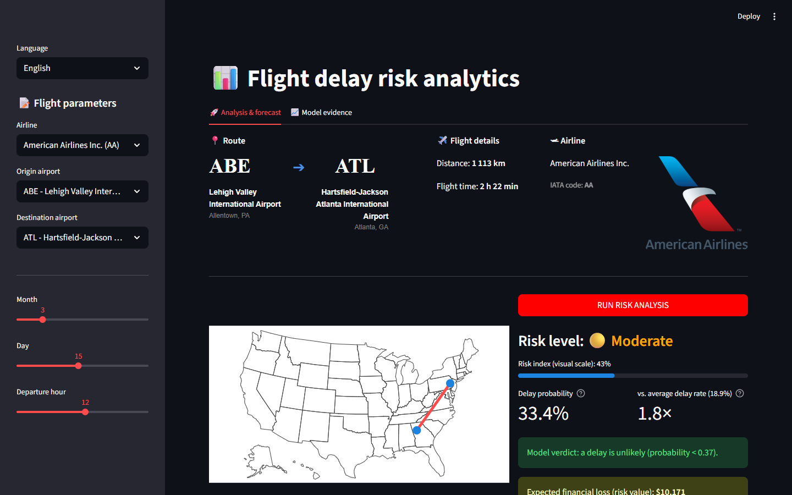
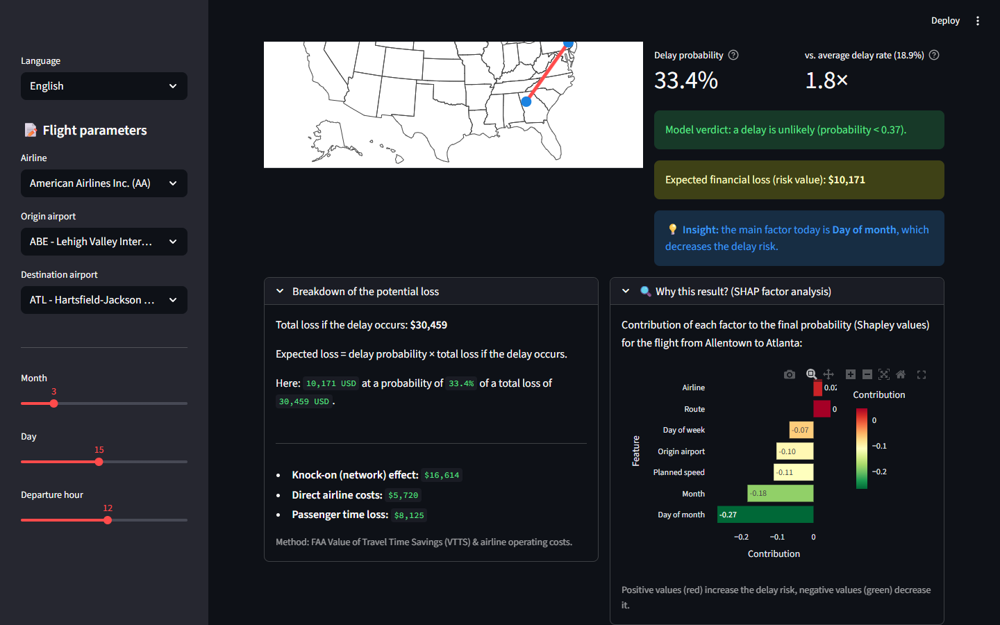
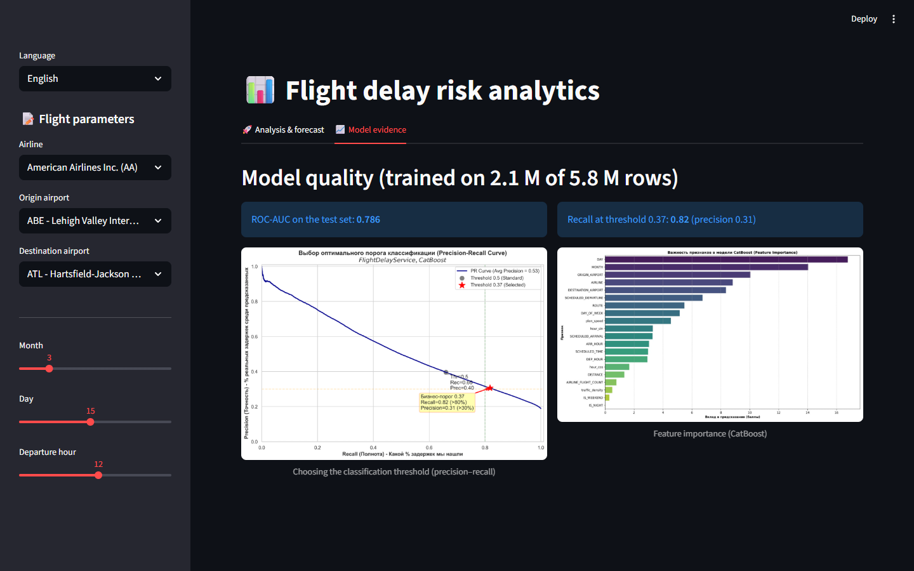
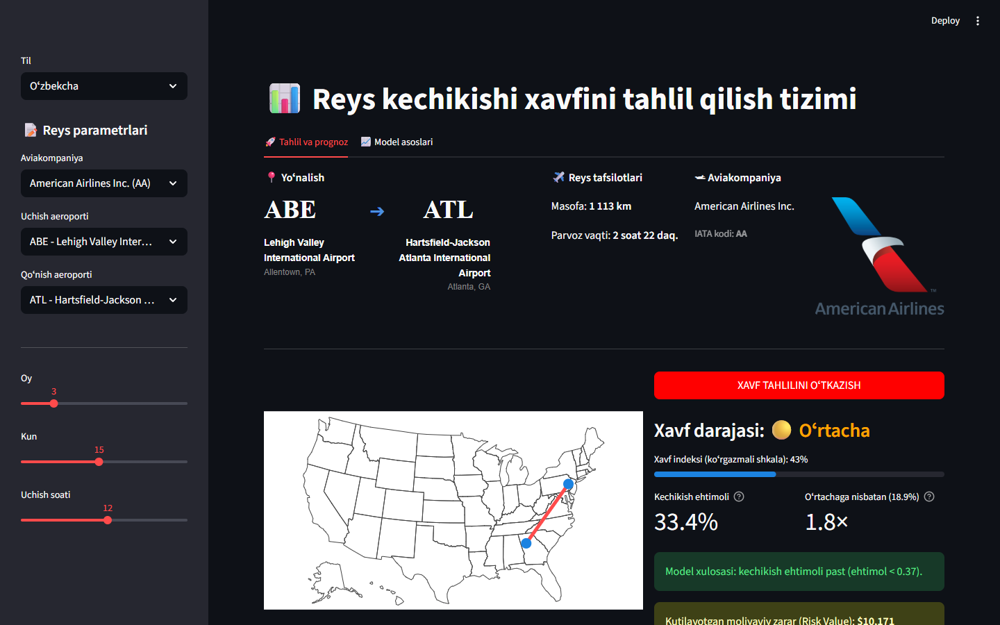
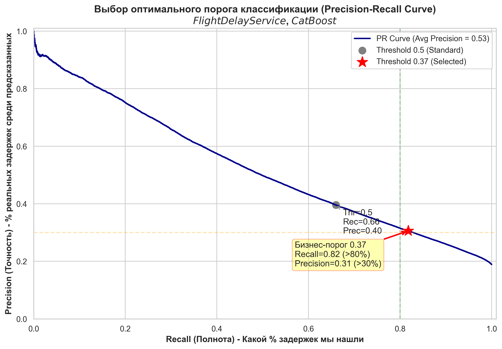

# Прогнозирование задержек авиарейсов и анализ рисков

[English](README.md) · [Oʻzbekcha](README.uz.md) · **Русский**

[](https://www.python.org/)
[](https://catboost.ai/)
[](https://streamlit.io/)
[](Dockerfile)
[](https://huggingface.co/AskarT/flight-delay-catboost)
[](LICENSE)

Полный ML-сервис, который оценивает вероятность того, что внутренний рейс по США прилетит
**с опозданием более чем на 15 минут** (определение задержки по FAA), используя только то, что
известно на этапе планирования: авиакомпанию, аэропорты вылета и прилёта, дату, час вылета,
расстояние и плановое время полёта. Поверх прогноза приложение объясняет, *почему* получен такой
результат (значения Шепли для конкретного рейса), и переводит риск в **ожидаемый финансовый ущерб**
по стоимостным нормативам FAA.

**🚀 Живая демонстрация:** https://huggingface.co/spaces/AskarT/flight-delay-risk
*(бесплатный CPU Space: засыпает после 48 часов без посетителей, первое открытие занимает около минуты, пока скачивается модель)*



| Объяснение и экономика | Обоснование модели |
|:--:|:--:|
|  |  |

---

## Содержание

1. [Что делает сервис](#что-делает-сервис)
2. [Данные](#данные)
3. [Подход](#подход)
4. [Результаты](#результаты)
5. [Артефакты модели](#артефакты-модели)
6. [Запуск](#запуск)
7. [Структура проекта](#структура-проекта)
8. [Ограничения и планы](#ограничения-и-планы)
9. [Документация и автор](#документация-и-автор)

---

## Что делает сервис

* **Прогноз** — классификатор CatBoost возвращает сырую вероятность значительной задержки.
  Бизнес-порог решения — **0.37** (подобран под полноту, см. [Результаты](#результаты)):
  при этом значении и выше вердикт «задержка вероятна».
* **Контекст** — вероятность сравнивается со средней долей задержек в данных (18,9 %), поэтому
  пользователь видит «в 1,8 раза выше средней», а не абстрактное число. Шкала *индекса риска*
  растягивает вероятность вокруг порога только для наглядности; это не калибровка.
* **Объяснение** — значения Шепли, которые CatBoost считает сам, показывают, какие факторы
  сдвинули именно этот рейс в сторону задержки или от неё (аэропорт, маршрут, день, час,
  авиакомпания и т. д.).
* **Экономика** — ожидаемый ущерб = вероятность × полная стоимость события задержки. Стоимость
  события складывается из прямых операционных расходов авиакомпании (110 USD за минуту задержки),
  времени пассажиров (FAA Value of Travel Time Savings, 62,50 USD за пассажиро-час) и коэффициента
  2,2× на каскадные задержки по сети.
* **Три языка интерфейса** — английский, узбекский (латиница) и русский. Приложение открывается
  на языке браузера (`uz*` → узбекский, `ru*` → русский, остальное → английский), переключатель
  в сайдбаре.



## Данные

* **Источник:** Kaggle — [2015 Flight Delays and Cancellations](https://www.kaggle.com/datasets/usdot/flight-delays)
  (Министерство транспорта США, Bureau of Transportation Statistics). 5,8 млн внутренних рейсов США
  за 2015 год: `flights.csv` на 565 МБ плюс справочники `airlines.csv` и `airports.csv`.
* **В репозитории:** только два маленьких справочника и таблица маршрутов, полученная из данных
  (`models/lookup_data.joblib`). Сырой `flights.csv` **не коммитится**; он нужен только для
  переобучения. Скачайте его через [Kaggle CLI](https://github.com/Kaggle/kaggle-api):

  ```bash
  kaggle datasets download -d usdot/flight-delays -p data --unzip
  ```

* **Обучающая выборка:** первые 2,1 млн строк (80 % обучение / 20 % стратифицированный тест).
  Таргет: `ARRIVAL_DELAY > 15` минут; доля положительного класса ≈ 18,9 %.
* **Контроль утечек:** используются только колонки, известные до вылета
  (`MONTH, DAY, DAY_OF_WEEK, AIRLINE, ORIGIN_AIRPORT, DESTINATION_AIRPORT, SCHEDULED_DEPARTURE,
  SCHEDULED_ARRIVAL, SCHEDULED_TIME, DISTANCE`). Фактические времена вылета/прилёта, время руления,
  бортовые номера и причины задержек исключены.

## Подход

**Проектирование признаков** — кастомный трансформер scikit-learn `FlightFeatureEngineer`
(`src/feature_engineering.py`) стоит первым шагом пайплайна, поэтому одна и та же логика
применяется при обучении и при прогнозе:

| Признак | Идея |
|---|---|
| `hour_sin`, `hour_cos` | час вылета как точка на окружности (23:00 близко к 00:00) |
| `traffic_density` | число вылетов из аэропорта в этот час этого дня (загрузка ВПП и терминалов) |
| `AIRLINE_FLIGHT_COUNT` | рейсы авиакомпании из этого аэропорта за день (нагрузка на экипажи и борта, «эффект домино») |
| `ROUTE` | пара вылет–прилёт как категория (перегруженные коридоры) |
| `plan_speed` | расстояние / плановое время: плотное расписание не оставляет запаса нагнать в воздухе |
| `IS_NIGHT`, `IS_WEEKEND` | вылеты 00:00–05:59; суббота/воскресенье |

Статистика трафика вычисляется только на обучающей части (`fit`) и подставляется при прогнозе.

**Модель** — `CatBoostClassifier` внутри `sklearn.pipeline.Pipeline`, обучение на GPU
(`src/train_final.py`): 2500 итераций, learning rate 0.03, глубина 7, `l2_leaf_reg=12`,
`scale_pos_weight=4.2` против дисбаланса классов 81/19, бернуллиевский сабсэмплинг 0.8,
ранняя остановка по AUC (100 раундов). Категориальные признаки обрабатываются упорядоченными
целевыми статистиками CatBoost: `MONTH, DAY, DAY_OF_WEEK, AIRLINE, ORIGIN_AIRPORT,
DESTINATION_AIRPORT, ROUTE, IS_WEEKEND, IS_NIGHT`. Время обучения: около 11 минут на RTX 4050.

**Порог** — стандартный 0.5 ловит лишь 66 % задержек. Поскольку пропущенная задержка
(ложноотрицательный ответ) обходится авиакомпании дороже ложной тревоги, порог перебрали и
зафиксировали на **0.37**: полнота 0.82 при точности 0.31.

**Объяснимость** — `src/analytics.py` запрашивает у CatBoost SHAP-значения для строки
(`get_feature_importance(type="ShapValues")`) и показывает семь самых сильных вкладов.

## Результаты

Тестовая выборка: 408 907 рейсов (20 % отложенных данных). Источник истины: [`reports/metrics/`](reports/metrics/).

| Метрика | Значение |
|---|---|
| ROC-AUC | **0.786** |
| Recall (полнота) @ 0.37 (выбранный порог) | **0.82** |
| Precision (точность) @ 0.37 | 0.31 |
| Recall / Precision @ 0.50 | 0.66 / 0.40 |
| Accuracy @ 0.50 | 0.75 |

Перебор порогов (`reports/metrics/recall085_results.txt`):

| Порог | 0.20 | 0.25 | 0.30 | 0.35 | **0.37** | 0.40 | 0.45 | 0.50 |
|---|---|---|---|---|---|---|---|---|
| Recall | 0.967 | 0.933 | 0.891 | 0.840 | **0.818** | 0.783 | 0.723 | 0.660 |
| Precision | 0.220 | 0.240 | 0.265 | 0.293 | **0.306** | 0.325 | 0.359 | 0.396 |

| Кривая precision–recall | Важность признаков |
|:--:|:--:|
|  |  |

Ранние эксперименты (PCA, ансамбли с LightGBM, таргеты 30/45 минут) сохранены в
`notebooks/archive/` и `reports/figures/`; финальная модель превзошла их все по ROC-AUC.

## Артефакты модели

| Файл | Размер | Где | Нужен приложению |
|---|---|---|---|
| `model_pipeline_main.pkl` — полный пайплайн (трансформер признаков + CatBoost), joblib `compress=3` | 433 МБ | [Hugging Face Hub](https://huggingface.co/AskarT/flight-delay-catboost) | **да** |
| `catboost_model_main.cbm` — та же модель CatBoost в родном формате | 1,29 ГБ | только локально | нет |
| `lookup_data.joblib` — маршруты, аэропорты, авиакомпании для интерфейса | 0,1 МБ | этот репозиторий | да |

Модель большая, потому что CatBoost хранит таблицы счётчиков (CTR) для категориальных признаков
с большим числом значений, таких как `ROUTE` (≈ 4 200 значений) и `DAY`.

**Логика загрузки** (`src/model_loader.py`): если `models/model_pipeline_main.pkl` есть локально,
используется он; иначе файл один раз скачивается с Hub через `huggingface_hub` и кэшируется.
Источник переопределяется переменными окружения `HF_MODEL_REPO` и `HF_MODEL_FILE`.

**Совместимость:** pickle привязан к Python 3.10, catboost 1.2.8, scikit-learn 1.7.2,
numpy 2.2.6, pandas 2.3.3 (всё закреплено в `requirements.txt`) и к классу из
`src/feature_engineering.py`. Изменение этого файла требует переобучения.

## Запуск

### Локально (Python 3.10)

```bash
git clone https://github.com/Askar-Turanazarov/FlightDelay-Service.git
cd FlightDelay-Service
python -m venv venv
venv\Scripts\activate            # Windows   |   на Linux/macOS: source venv/bin/activate
pip install -r requirements.txt
streamlit run src/app.py
```

На Windows достаточно дважды щёлкнуть `START_PROJECT.bat`: он создаст venv, установит зависимости
и запустит приложение на первом свободном порту начиная с 8505.

Модель скачивается с Hugging Face при первом запуске (433 МБ). Чтобы использовать локальную копию,
положите её в `models/model_pipeline_main.pkl`.

### Docker

```bash
docker build -t flt-delay-app .
docker run -p 8501:8501 flt-delay-app
```

Затем откройте http://localhost:8501. Полезные варианты:

```bash
# использовать локальный файл модели вместо скачивания
docker run -p 8501:8501 -v "$PWD/models:/app/models:ro" flt-delay-app

# зеркало PyPI, если стандартный CDN в вашем регионе медленный
docker build --build-arg PIP_INDEX_URL=https://pypi.tuna.tsinghua.edu.cn/simple -t flt-delay-app .
```

Образ (python 3.10-slim, непривилегированный пользователь, health check на `/_stcore/health`)
тот же, что работает в Hugging Face Space. Его размер около 1,6 ГБ, почти всё это CatBoost,
SciPy и pyarrow.

### Переобучение

```bash
kaggle datasets download -d usdot/flight-delays -p data --unzip
pip install -r requirements-dev.txt
python src/train_final.py          # по умолчанию GPU; иначе поставьте task_type="CPU" в скрипте
```

EDA и история обучения — в `notebooks/01_EDA_and_Training.ipynb`.

## Структура проекта

```
flight_delay_service/
├── src/
│   ├── app.py                 интерфейс Streamlit
│   ├── analytics.py           индекс риска, относительный риск, SHAP-объяснения
│   ├── feature_engineering.py FlightFeatureEngineer (часть сериализованного пайплайна)
│   ├── model_loader.py        локальный файл или загрузка с Hugging Face Hub
│   ├── train_final.py         скрипт обучения
│   └── i18n/                  en.py, uz.py, ru.py + определение языка
├── data/                      airlines.csv, airports.csv (flights.csv скачивается, не коммитится)
├── models/                    lookup_data.joblib (+ скачиваемый model_pipeline_main.pkl)
├── reports/figures/           PR-кривая, важность признаков, матрицы ошибок
├── reports/metrics/           сырые отчёты с метриками обучения
├── notebooks/                 01_EDA_and_Training.ipynb, archive/ с экспериментами
├── docs/                      Report.pdf, Tech_report.pdf (на русском), img/ скриншоты
├── logos/                     логотипы авиакомпаний для интерфейса
├── Dockerfile · requirements.txt · requirements-dev.txt · START_PROJECT.bat
```

## Ограничения и планы

* **Размер модели.** 433 МБ в сжатом виде / около 1,3 ГБ в памяти. Планируется компактное
  переобучение (`max_ctr_complexity=1`, `DAY` и `ROUTE` не как категории).
* **Индекс риска не калибровка.** Главное отображаемое число — сырая вероятность; шкала индекса
  лишь визуальное преобразование. Полноценный шаг `CalibratedClassifierCV` в планах.
* **Только данные США за 2015 год.** Аэропорты, авиакомпании и трафик относятся к 2015 году;
  приложение демонстрирует метод, а не является рабочим инструментом.
* **Признакам трафика нужны известные даты.** `traffic_density` и `AIRLINE_FLIGHT_COUNT` берутся
  из статистики обучения для выбранных аэропорта/дня/часа; для невиданных сочетаний ставится 1.
* В планах: pytest для трансформера, загрузчика и переводов; GitHub Actions (линтер + сборка Docker).

## Документация и автор

* `docs/Report.pdf` — дипломный отчёт, `docs/Tech_report.pdf` — технический отчёт (оба на русском).
* Карточка модели: https://huggingface.co/AskarT/flight-delay-catboost

**Аскар Тураназаров (Askar Turanazarov)** — дипломный проект по Data Science, 2026. Распространяется под [лицензией MIT](LICENSE).
