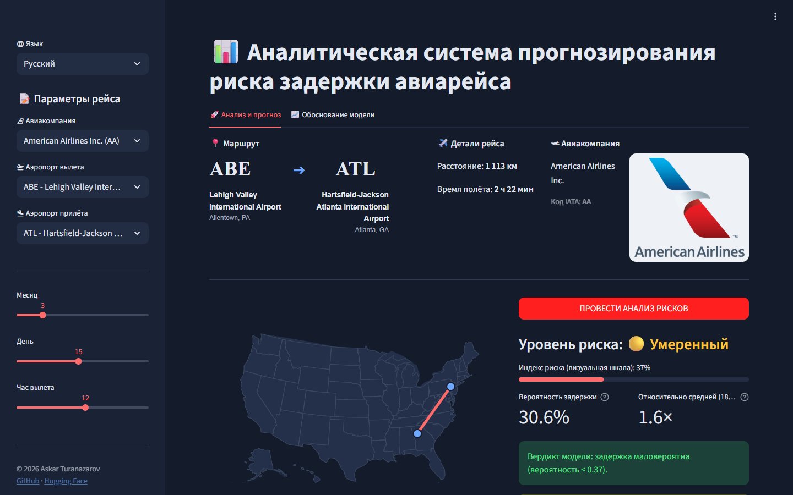
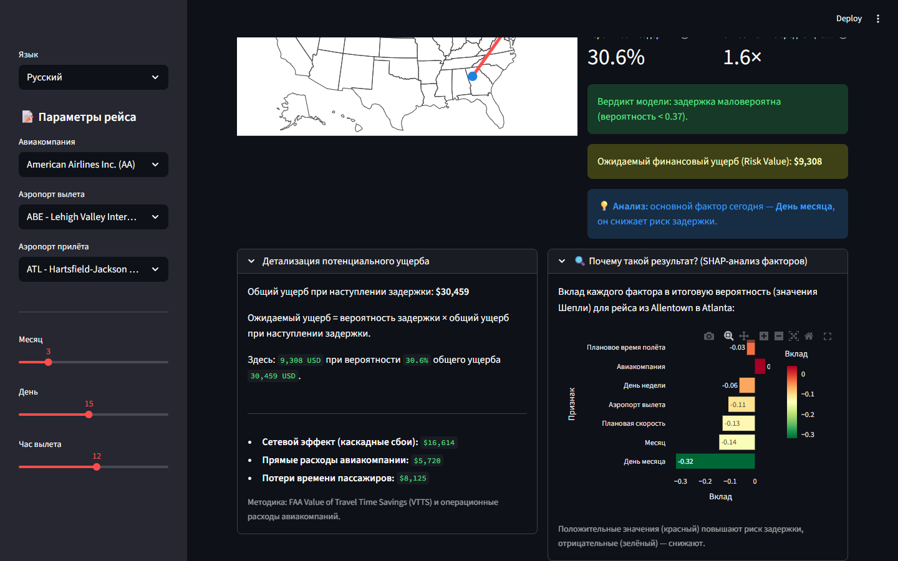
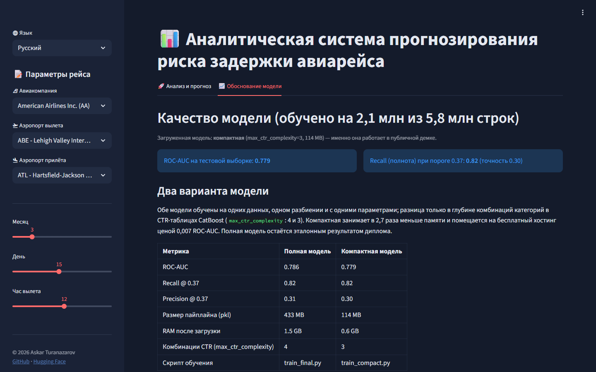

# Прогнозирование задержек авиарейсов и анализ рисков

[English](README.md) · [Oʻzbekcha](README.uz.md) · **Русский**

[](https://www.python.org/)
[](https://catboost.ai/)
[](https://streamlit.io/)
[](Dockerfile)
[](https://huggingface.co/AskarT/flight-delay-catboost)
[](LICENSE)

Полный ML-сервис, который оценивает вероятность того, что внутренний рейс по США прилетит
**с опозданием более чем на 15 минут** (определение задержки по FAA), используя только то, что
известно на этапе планирования: авиакомпанию, аэропорты вылета и прилёта, дату, час вылета,
расстояние и плановое время полёта, а для модели по умолчанию ещё и ожидаемую погоду в обоих аэропортах. Поверх прогноза приложение объясняет, *почему* получен такой
результат (значения Шепли для конкретного рейса), и переводит риск в **ожидаемый финансовый ущерб**
по стоимостным нормативам FAA.

**🚀 Живая демонстрация:** https://flight-delay-askar.streamlit.app · страница проекта на [Hugging Face Spaces](https://huggingface.co/spaces/AskarT/flight-delay-risk)
*(бесплатный Streamlit Community Cloud: засыпает после 12 часов без посетителей, первое открытие занимает около минуты, пока скачивается модель. Модель выбирается в сайдбаре: по умолчанию [модель с погодой](#варианты-модели) или компактная дипломная модель; `?model=compact` в адресе открывает вторую.)*



| Объяснение и экономика | Обоснование модели |
|:--:|:--:|
|  |  |

---

## Содержание

1. [Что делает сервис](#что-делает-сервис)
2. [Данные](#данные)
3. [Подход](#подход)
4. [Результаты](#результаты)
5. [Варианты модели](#варианты-модели)
6. [Артефакты модели](#артефакты-модели)
7. [Запуск](#запуск)
8. [Структура проекта](#структура-проекта)
9. [Ограничения и планы](#ограничения-и-планы)
10. [Документация и автор](#документация-и-автор)

---

## Что делает сервис

* **Прогноз** — классификатор CatBoost возвращает вероятность значительной задержки. Есть три
  [варианта модели](#варианты-модели), переключатель в сайдбаре. **Модель с погодой**, которая
  работает по умолчанию, учитывает также ветер, видимость, осадки и опасные явления в обоих
  аэропортах и возвращает откалиброванную вероятность с порогом **0.20**. Дипломные модели
  возвращают сырую вероятность с порогом **0.37** (подобран под полноту, см. [Результаты](#результаты)).
  При значении порога и выше вердикт «задержка вероятна».
* **Контекст** — вероятность сравнивается со средней долей задержек в данных модели
  (17,9 % за весь 2015 год, 18,9 % в данных диплома), поэтому пользователь видит «в 1,8 раза выше
  средней», а не абстрактное число. Шкала *индекса риска* растягивает вероятность вокруг порога только для наглядности; это не калибровка.
* **Объяснение** — значения Шепли, которые CatBoost считает сам, показывают, какие факторы
  сдвинули именно этот рейс в сторону задержки или от неё (аэропорт, маршрут, день, час,
  авиакомпания и т. д.).
* **Экономика** — ожидаемый ущерб = вероятность × полная стоимость события задержки. Стоимость
  события складывается из прямых операционных расходов авиакомпании (110 USD за минуту задержки),
  времени пассажиров (FAA Value of Travel Time Savings, 62,50 USD за пассажиро-час) и коэффициента
  2,2× на каскадные задержки по сети.
* **Три языка интерфейса** — английский, узбекский (латиница) и русский. Приложение открывается
  на языке браузера (`uz*` → узбекский, `ru*` → русский, остальное → английский), переключатель
  в сайдбаре. Скриншоты в этом файле показывают русский интерфейс; английский и узбекский см. в
  [README.md](README.md) и [README.uz.md](README.uz.md).

## Данные

* **Источник:** Kaggle — [2015 Flight Delays and Cancellations](https://www.kaggle.com/datasets/usdot/flight-delays)
  (Министерство транспорта США, Bureau of Transportation Statistics). 5,8 млн внутренних рейсов США
  за 2015 год: `flights.csv` на 565 МБ плюс справочники `airlines.csv` и `airports.csv`.
* **В репозитории:** только два маленьких справочника и таблица маршрутов, полученная из данных
  (`models/lookup_data.joblib`). Сырой `flights.csv` **не коммитится**; он нужен только для
  переобучения. Скачайте его через [Kaggle CLI](https://github.com/Kaggle/kaggle-api):

  ```bash
  kaggle datasets download -d usdot/flight-delays -p data --unzip
  ```

* **Обучающая выборка:** первые 2,1 млн строк (80 % обучение / 20 % стратифицированный тест).
  Таргет: `ARRIVAL_DELAY > 15` минут; доля положительного класса ≈ 18,9 %.
* **Контроль утечек:** используются только колонки, известные до вылета
  (`MONTH, DAY, DAY_OF_WEEK, AIRLINE, ORIGIN_AIRPORT, DESTINATION_AIRPORT, SCHEDULED_DEPARTURE,
  SCHEDULED_ARRIVAL, SCHEDULED_TIME, DISTANCE`). Фактические времена вылета/прилёта, время руления,
  бортовые номера и причины задержек исключены.

## Подход

**Проектирование признаков** — кастомный трансформер scikit-learn `FlightFeatureEngineer`
(`src/feature_engineering.py`) стоит первым шагом пайплайна, поэтому одна и та же логика
применяется при обучении и при прогнозе:

| Признак | Идея |
|---|---|
| `hour_sin`, `hour_cos` | час вылета как точка на окружности (23:00 близко к 00:00) |
| `traffic_density` | число вылетов из аэропорта в этот час этого дня (загрузка ВПП и терминалов) |
| `AIRLINE_FLIGHT_COUNT` | рейсы авиакомпании из этого аэропорта за день (нагрузка на экипажи и борта, «эффект домино») |
| `ROUTE` | пара вылет–прилёт как категория (перегруженные коридоры) |
| `plan_speed` | расстояние / плановое время: плотное расписание не оставляет запаса нагнать в воздухе |
| `IS_NIGHT`, `IS_WEEKEND` | вылеты 00:00–05:59; суббота/воскресенье |

Статистика трафика вычисляется только на обучающей части (`fit`) и подставляется при прогнозе.

**Модель** — `CatBoostClassifier` внутри `sklearn.pipeline.Pipeline`, обучение на GPU
(`src/train_final.py`): 2500 итераций, learning rate 0.03, глубина 7, `l2_leaf_reg=12`,
`scale_pos_weight=4.2` против дисбаланса классов 81/19, бернуллиевский сабсэмплинг 0.8,
ранняя остановка по AUC (100 раундов). Категориальные признаки обрабатываются упорядоченными
целевыми статистиками CatBoost: `MONTH, DAY, DAY_OF_WEEK, AIRLINE, ORIGIN_AIRPORT,
DESTINATION_AIRPORT, ROUTE, IS_WEEKEND, IS_NIGHT`. Время обучения: около 11 минут на RTX 4050.

**Порог** — стандартный 0.5 ловит лишь 66 % задержек. Поскольку пропущенная задержка
(ложноотрицательный ответ) обходится авиакомпании дороже ложной тревоги, порог перебрали и
зафиксировали на **0.37**: полнота 0.82 при точности 0.31.

**Объяснимость** — `src/analytics.py` запрашивает у CatBoost SHAP-значения для строки
(`get_feature_importance(type="ShapValues")`) и показывает семь самых сильных вкладов.

## Результаты

Тестовая выборка: 408 907 рейсов (20 % отложенных данных). Источник истины: [`reports/metrics/`](reports/metrics/).
Цифры ниже относятся к **полной модели** (`train_final.py`), эталонному результату диплома; компактный
вариант и модель с погодой из живой демки сравниваются с ней в разделе [Варианты модели](#варианты-модели).

| Метрика | Значение |
|---|---|
| ROC-AUC | **0.786** |
| Recall (полнота) @ 0.37 (выбранный порог) | **0.82** |
| Precision (точность) @ 0.37 | 0.31 |
| Recall / Precision @ 0.50 | 0.66 / 0.40 |
| Accuracy @ 0.50 | 0.75 |

Перебор порогов (`reports/metrics/recall085_results.txt`):

| Порог | 0.20 | 0.25 | 0.30 | 0.35 | **0.37** | 0.40 | 0.45 | 0.50 |
|---|---|---|---|---|---|---|---|---|
| Recall | 0.967 | 0.933 | 0.891 | 0.840 | **0.818** | 0.783 | 0.723 | 0.660 |
| Precision | 0.220 | 0.240 | 0.265 | 0.293 | **0.306** | 0.325 | 0.359 | 0.396 |

| Кривая precision–recall | Важность признаков |
|:--:|:--:|
|  |  |

[Результаты](#результаты) выше относятся к дипломной модели; модель с погодой описана в разделе
[Варианты модели](#варианты-модели).

Ранние эксперименты (PCA, ансамбли с LightGBM, таргеты 30/45 минут) сохранены в
`notebooks/archive/` и `reports/figures/`; финальная модель превзошла их все по ROC-AUC.

## Варианты модели

| | Модель с погодой (по умолчанию) | Компактная дипломная модель | Полная дипломная модель |
|---|---|---|---|
| Входные данные | рейс + погода в обоих аэропортах | только рейс | только рейс |
| Обучение | весь 2015 год без 73 целых дней (292 дня) | первые 2,1 млн рейсов 2015 года (январь–май), деление 80 / 20 | как у компактной |
| Проверка | 73 скрытых дня, 1,1 млн рейсов | случайные 20 % тех же месяцев | как у компактной |
| ROC-AUC на своей проверке | 0.698 | 0.779 | 0.786 |
| ROC-AUC на новых датах | **0.698** (73 дня) | 0.637 (июнь–декабрь) | 0.630 (июнь–декабрь) |
| Вероятность | откалибрована (изотоническая калибровка) | сырая | сырая |
| Порог / recall / precision | 0.20 / 0.54 / 0.31 | 0.37 / 0.82 / 0.30 | 0.37 / 0.82 / 0.31 |
| Пайплайн на диске / RAM | 40 МБ / 0,4 ГБ | 114 МБ / 0,6 ГБ | 433 МБ / 1,5 ГБ |
| Доступна в приложении | всегда, по умолчанию | всегда | только там, где её файл лежит в `models/` |

Столбцы измерены на разных проверках, поэтому сравнивать их можно только по строке «ROC-AUC на новых датах».

### Модель с погодой (по умолчанию)

**Зачем она.** Дипломные модели дают 0.78 на случайных рейсах, но эти рейсы взяты из дат, которые
модель уже видела при обучении. На новых датах (июнь–декабрь) они дают 0.63–0.64: отчасти модели
запоминают плохие дни. Больше данных почти не помогло: та же схема, обученная на всём годе, даёт 0.659
на 73 скрытых днях. Погода стала первым входом, который поднял качество на новых датах: 0.659 → 0.699.

**Что она добавляет.** Часовые сводки METAR за 2015 год (Iowa Environmental Mesonet): худшие условия
часа в аэропорту вылета в час вылета и в аэропорту прилёта в час прилёта, сведённые к четырём
категориальным признакам для каждого аэропорта: ветер (слабый < 10 узлов, умеренный 10–19, сильный 20–33, шторм ≥ 34),
видимость (хорошая ≥ 5 миль, пониженная 1–5, плохая < 1), осадки (нет, дождь, снег, ледяной дождь) и
опасные явления (нет, туман, гроза, обледенение, другое).

**Почему облегчённая версия.** Комбинации категорий ограничены двумя признаками (`max_ctr_complexity=2`):
качество на новых датах то же, что и с тремя (0.698 против 0.699), файл 40 МБ вместо 170 МБ, памяти
вдвое меньше, поэтому обе модели демо помещаются на бесплатный хостинг одновременно.

**Вероятность и порог.** Сырой выход завышен весом класса (в среднем 0.41 при доле задержек 0.18),
поэтому он проходит изотоническую калибровку (`models/calibration_weather.json`): 20 % означает, что
опоздал примерно каждый пятый такой рейс. Тревога поднимается с 0.20 — это верный порог, если
пропущенная задержка стоит примерно четырёх ложных тревог; при нём модель ловит 54 % задержек, и 31 %
её тревог оправдываются. Уровни риска: низкий < 0.12, умеренный 0.12–0.20, высокий 0.20–0.35,
критический ≥ 0.35; на 73 тестовых днях из рейсов этих уровней опоздали 8 %, 16 %, 25 % и 48 %.

**Ограничения.** Модель училась на погоде, которая была на самом деле, а приложение принимает прогноз,
поэтому в реальной работе качество ниже 0.698. Полный отчёт: `reports/metrics/weather_model_results.txt`.
Скриптов обучения этой модели в репозитории пока нет.

### Компактная дипломная модель

Полная модель занимает 433 МБ на диске и около **1,5 ГБ в памяти** (пик 2,8 ГБ при распаковке pickle),
потому что CatBoost хранит таблицы счётчиков (CTR) для комбинаций до четырёх категориальных признаков
(`ROUTE` ≈ 4 200 значений × `DAY` × `MONTH` × ...). Для ноутбука или Docker-хоста это не проблема, но
бесплатный тариф Streamlit Community Cloud, где живёт публичная демка, даёт 1 ГБ (жёсткий предел 2,7 ГБ),
и приложение убивалось на старте. Hugging Face Docker Spaces, изначально планировавшийся хостинг, с 2026
года стал платным.

Вместо того чтобы урезать дипломную модель, **добавлен второй, компактный вариант**. На тех же 2,1 млн
строк и том же разбиении обучены шесть конфигураций (все результаты в
`reports/metrics/compact_experiments.txt`); лучшим компромиссом оказалось ограничение комбинаций CTR
тремя признаками (`max_ctr_complexity=3`):

| | Полная модель | Компактная модель |
|---|---|---|
| Скрипт | `src/train_final.py` | `src/train_compact.py` |
| Настройки CatBoost | 2500 ит., lr 0.03, глубина 7, комбинации CTR ≤ 4 (по умолчанию) | те же, комбинации CTR ≤ 3 |
| ROC-AUC (тест) | **0.786** | **0.779** |
| Recall / precision @ 0.37 | 0.82 / 0.31 | 0.82 / 0.30 |
| Пайплайн на диске (`.pkl`) | 433 МБ | 114 МБ |
| RAM после загрузки / пик | 1,5 ГБ / 2,8 ГБ | 0,6 ГБ / 0,9 ГБ |
| Где работает | локально, Docker, `MODEL_VARIANT=full` | **живая демка**, по умолчанию везде |

Оба файла опубликованы в одном [репозитории Hugging Face](https://huggingface.co/AskarT/flight-delay-catboost).
Остальные опробованные конфигурации (комбинации CTR ≤ 2 → AUC 0.754–0.759 при 36–52 МБ; ≤ 1 → AUC
0.733–0.751 при 5–7 МБ) теряют слишком много качества: комбинации категорий высокого порядка несут
реальный сигнал.

Скриншоты в начале этого README сняты на компактной модели, до появления выбора модели. Отдельные
прогнозы двух дипломных вариантов немного различаются (например, JFK → LAX 15 июля в 18:00: 0,375 у полной
и 0,469 у компактной), поэтому цифры на скриншоте зависят от того, какая модель их выдала.

<details>
<summary>Скриншоты полной модели (сняты до появления компактного варианта)</summary>

> Интерфейс тот же; вероятности, вклады SHAP и ожидаемый ущерб на этих изображениях получены полной
> моделью на 433 МБ и немного отличаются от живой демки, где работает компактная модель.


| Объяснение и экономика | Обоснование модели |
|:--:|:--:|
|  |  |


</details>

## Артефакты модели

| Файл | Размер | Где | Нужен приложению |
|---|---|---|---|
| `model_pipeline_weather.pkl` — пайплайн с погодой (трансформер признаков + CatBoost, 21 входной признак) | 40 МБ | [Hugging Face Hub](https://huggingface.co/AskarT/flight-delay-catboost) | **да, по умолчанию** |
| `calibration_weather.json` — изотоническая калибровка, порог и уровни риска модели с погодой | 8 КБ | этот репозиторий | с моделью с погодой |
| `model_pipeline_compact.pkl` — компактный дипломный пайплайн, joblib `compress=3` | 114 МБ | [Hugging Face Hub](https://huggingface.co/AskarT/flight-delay-catboost) | да, выбирается в сайдбаре |
| `model_pipeline_main.pkl` — полный дипломный пайплайн, та же структура | 433 МБ | [Hugging Face Hub](https://huggingface.co/AskarT/flight-delay-catboost) | если файл лежит в `models/` или при `MODEL_VARIANT=full` |
| `catboost_model_compact.cbm`, `catboost_model_main.cbm` — те же модели CatBoost в родном формате | 326 МБ, 1,29 ГБ | только локально | нет |
| `lookup_data.joblib` — маршруты, аэропорты, авиакомпании для интерфейса | 0,1 МБ | этот репозиторий | да |

**Логика загрузки** (`src/model_loader.py`, `src/app.py`): посетитель выбирает модель в сайдбаре
(также `?model=weather|compact|full` в адресе). `MODEL_VARIANT` задаёт модель, которая открывается по
умолчанию (`weather`, если переменная не задана). Модель загружается, когда её впервые кто-то выбирает:
из `models/`, если pickle там есть, иначе один раз скачивается с Hub через `huggingface_hub` и
кэшируется. Затем она остаётся в памяти для всех посетителей серверного процесса (`st.cache_resource`,
по одной записи на модель), поэтому несколько секунд ждёт только первое переключение; обе модели демо
вместе занимают около 0,85 ГБ. `HF_MODEL_REPO` переопределяет репозиторий-источник, а `HF_MODEL_FILE` —
файл модели по умолчанию. Вкладка «Обоснование модели» показывает, какая модель загружена, и таблицу
сравнения выше.

**Совместимость:** pickle-файлы привязаны к Python 3.10, catboost 1.2.8, scikit-learn 1.7.2,
numpy 2.2.6, pandas 2.3.3 (всё закреплено в `requirements.txt`) и к классу из
`src/feature_engineering.py`. Изменение этого файла требует переобучения.

## Запуск

### Локально (Python 3.10)

```bash
git clone https://github.com/Askar-Turanazarov/FlightDelay-Service.git
cd FlightDelay-Service
python -m venv venv
venv\Scripts\activate            # Windows   |   на Linux/macOS: source venv/bin/activate
pip install -r requirements.txt
streamlit run src/app.py
```

На Windows достаточно дважды щёлкнуть `START_PROJECT.bat`: он создаст venv, установит зависимости
и запустит приложение на первом свободном порту начиная с 8505.

Модель с погодой скачивается с Hugging Face при первом запуске (40 МБ), компактная — когда её впервые
выбирают (114 МБ). Чтобы использовать локальные копии, положите их в `models/`. Для полной дипломной
модели (433 МБ, около 1,5 ГБ RAM) положите туда `model_pipeline_main.pkl` или дайте ей скачаться:

```bash
set MODEL_VARIANT=full          # Windows   |   на Linux/macOS: export MODEL_VARIANT=full
streamlit run src/app.py
```

### Docker

```bash
docker build -t flt-delay-app .
docker run -p 8501:8501 flt-delay-app
```

Затем откройте http://localhost:8501. Полезные варианты:

```bash
# использовать локальный файл модели вместо скачивания
docker run -p 8501:8501 -v "$PWD/models:/app/models:ro" flt-delay-app

# запустить полную дипломную модель вместо компактной (контейнеру нужно ~2 ГБ RAM)
docker run -p 8501:8501 -e MODEL_VARIANT=full flt-delay-app

# зеркало PyPI, если стандартный CDN в вашем регионе медленный
docker build --build-arg PIP_INDEX_URL=https://pypi.tuna.tsinghua.edu.cn/simple -t flt-delay-app .
```

Образ (python 3.10-slim, непривилегированный пользователь, health check на `/_stcore/health`) работает на
любом Docker-хосте, включая Hugging Face Docker Spaces (с 2026 года там платный тариф). Его размер около
1,6 ГБ, почти всё это CatBoost, SciPy и pyarrow. Публичная демка работает на Streamlit Community Cloud
прямо из этого репозитория.

### Переобучение

```bash
kaggle datasets download -d usdot/flight-delays -p data --unzip
pip install -r requirements-dev.txt
python src/train_final.py          # полная модель    -> models/model_pipeline_main.pkl    (GPU, ~11 мин на RTX 4050)
python src/train_compact.py        # компактная модель-> models/model_pipeline_compact.pkl (GPU, ~7 мин)
```

Оба скрипта используют один загрузчик, одно разбиение и одни параметры; без GPU поставьте внутри них
`task_type="CPU"` (намного медленнее). Компактный скрипт также пишет `reports/metrics/compact_model_results.txt`.

EDA и история обучения — в `notebooks/01_EDA_and_Training.ipynb`.

## Структура проекта

```
flight_delay_service/
├── src/
│   ├── app.py                 интерфейс Streamlit
│   ├── analytics.py           калибровка, уровни риска, относительный риск, SHAP-объяснения
│   ├── feature_engineering.py FlightFeatureEngineer (часть сериализованного пайплайна)
│   ├── model_loader.py        варианты модели, погодные входы, локальный файл или загрузка с Hub
│   ├── train_final.py         скрипт обучения, полная модель (эталон диплома)
│   ├── train_compact.py       скрипт обучения, компактная модель (живая демка)
│   └── i18n/                  en.py, uz.py, ru.py + определение языка
├── data/                      airlines.csv, airports.csv (flights.csv скачивается, не коммитится)
├── models/                    lookup_data.joblib, calibration_weather.json (+ скачиваемые pickle моделей)
├── reports/figures/           PR-кривая, важность признаков, матрицы ошибок
├── reports/metrics/           сырые отчёты с метриками обучения
├── notebooks/                 01_EDA_and_Training.ipynb, archive/ с экспериментами
├── docs/                      Report.pdf, Tech_report.pdf (на русском), img/{en,uz,ru}/ скриншоты
├── space/                     статическая страница для Hugging Face Space (встраивает живую демку)
├── logos/                     логотипы авиакомпаний для интерфейса
├── Dockerfile · requirements.txt · requirements-dev.txt · START_PROJECT.bat
```

## Ограничения и планы

* **Новые даты сложнее.** Дипломные модели дают 0.78 на случайных рейсах, но 0.63–0.64 на датах,
  которых не видели; модель с погодой достигает 0.698 на скрытых днях, а с реальным прогнозом вместо
  наблюдённой погоды качество ещё ниже. См. [Варианты модели](#варианты-модели).
* **Размер модели.** Полной модели нужно около 1,5 ГБ RAM, поэтому публичная демка предлагает модель
  с погодой и компактную дипломную модель (0,4 + 0,6 ГБ).
* **Калибровка.** Откалибрована только модель с погодой. Дипломные модели показывают сырую
  вероятность, завышенную весом класса; шкала индекса риска — лишь визуальное преобразование.
* **Только данные США за 2015 год.** Аэропорты, авиакомпании и трафик относятся к 2015 году;
  приложение демонстрирует метод, а не является рабочим инструментом.
* **Признакам трафика нужны известные даты.** `traffic_density` и `AIRLINE_FLIGHT_COUNT` берутся
  из статистики обучения для выбранных аэропорта/дня/часа; для невиданных сочетаний ставится 1.
* В планах: pytest для трансформера, загрузчика и переводов; GitHub Actions (линтер + сборка Docker).

## Документация и автор

* `docs/Report.pdf` — дипломный отчёт, `docs/Tech_report.pdf` — технический отчёт (оба на русском).
* Карточка модели: https://huggingface.co/AskarT/flight-delay-catboost
* Отчёты с метриками: `reports/metrics/` (`weather_model_results.txt`, `compact_model_results.txt`, ...).

**Аскар Тураназаров (Askar Turanazarov)** — дипломный проект по Data Science, 2026. Распространяется под [лицензией MIT](LICENSE).
