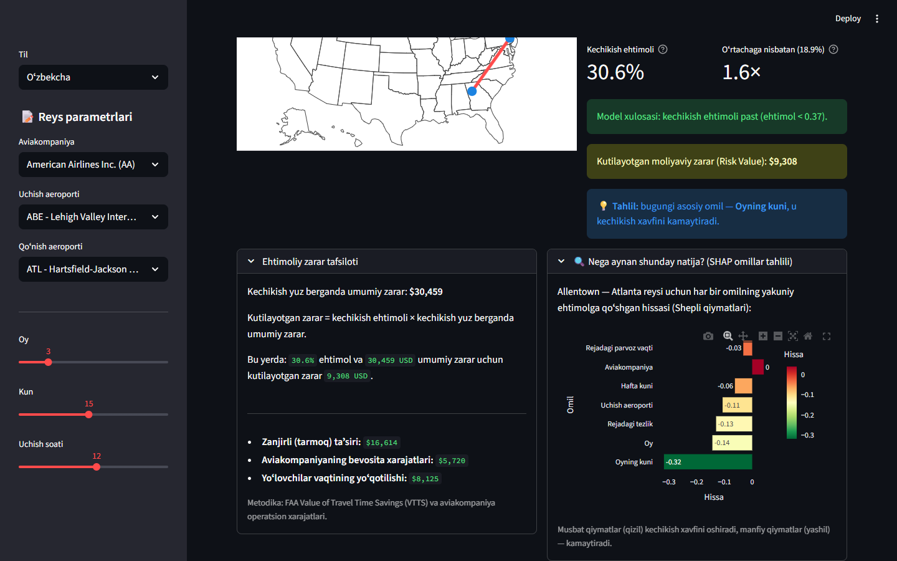
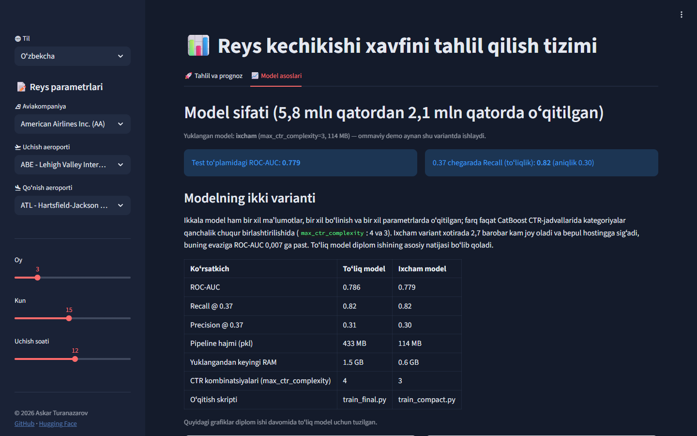
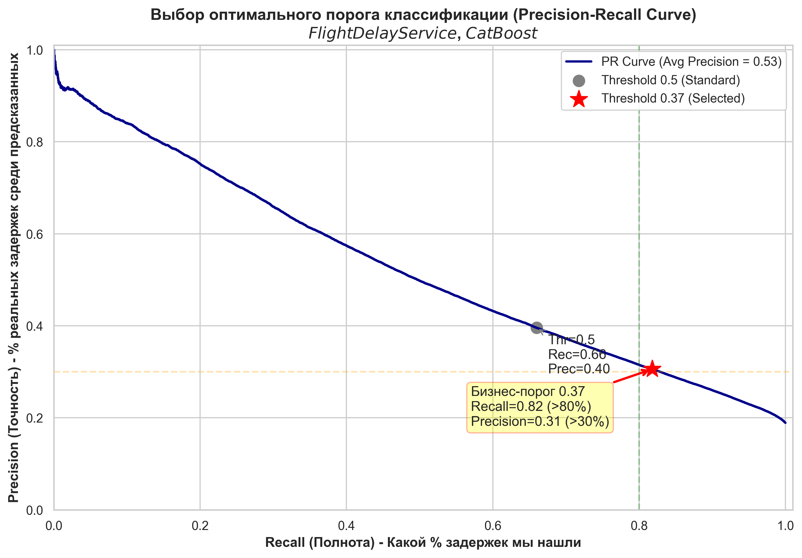
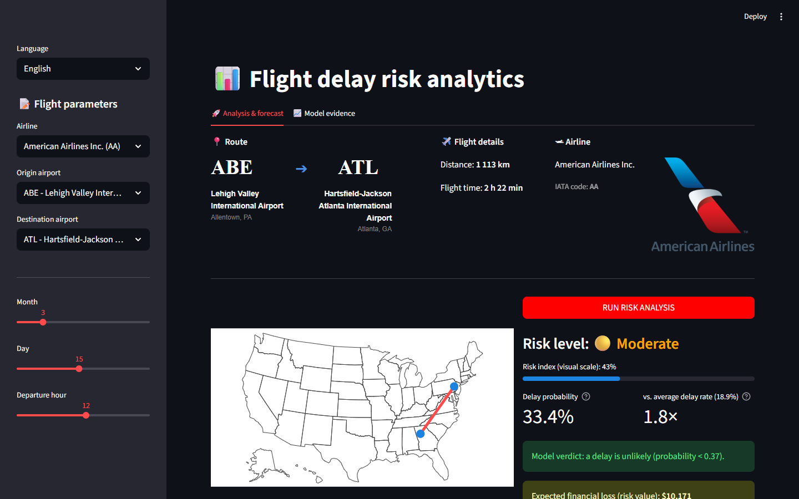
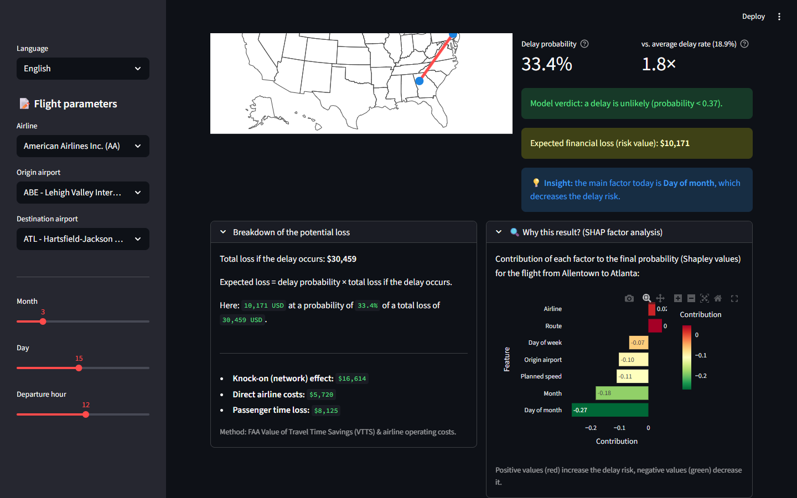
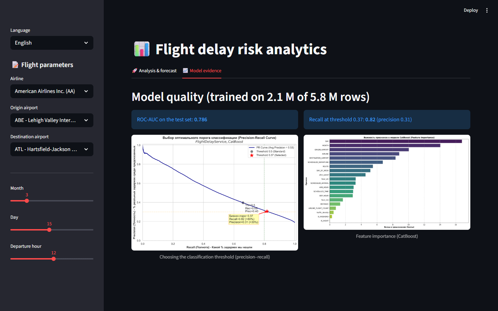
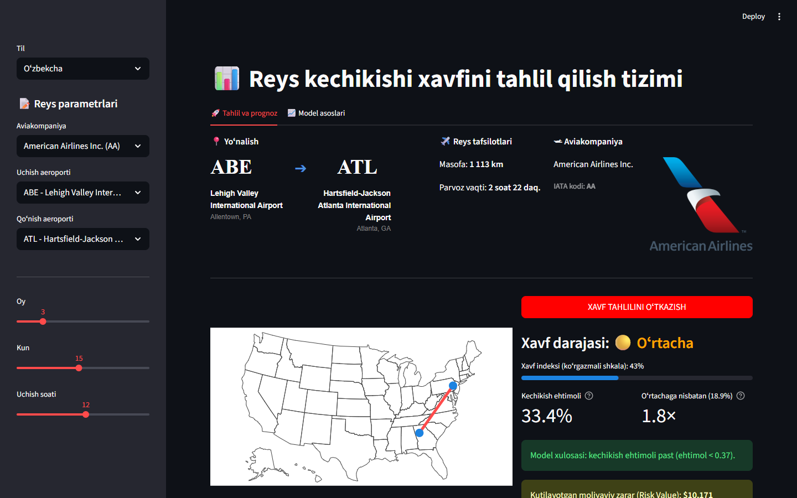

# Reys kechikishini bashorat qilish va xavf tahlili

[English](README.md) · **Oʻzbekcha** · [Русский](README.ru.md)

[](https://www.python.org/)
[](https://catboost.ai/)
[](https://streamlit.io/)
[](Dockerfile)
[](https://huggingface.co/AskarT/flight-delay-catboost)
[](LICENSE)

AQSH ichki reysining **15 daqiqadan koʻproq kechikib qoʻnish** ehtimolini (FAA boʻyicha kechikish
taʼrifi) baholaydigan toʻliq mashinaviy oʻrganish xizmati. Bashorat uchun faqat rejalashtirish
bosqichida maʼlum boʻlgan maʼlumotlar ishlatiladi: aviakompaniya, uchish va qoʻnish aeroportlari,
sana, uchish soati, masofa va rejadagi parvoz vaqti, sukut boʻyicha modelda esa ikkala aeroportdagi kutilayotgan ob-havo ham. Bashorat ustiga ilova *nima uchun* shunday
natija chiqqanini tushuntiradi (har bir reys uchun Shepli qiymatlari) va xavfni FAA xarajat
meʼyorlari asosida **kutilayotgan moliyaviy zararga** aylantiradi.

**🚀 Jonli demo:** https://flight-delay-askar.streamlit.app · loyiha sahifasi [Hugging Face Spaces](https://huggingface.co/spaces/AskarT/flight-delay-risk) da
*(bepul Streamlit Community Cloud: 12 soat tashrifsiz qolsa uxlab qoladi; birinchi ochilishda model yuklab olinadi va bir daqiqacha vaqt ketadi. Model yon panelda tanlanadi: sukut boʻyicha [ob-havo modeli](#model-variantlari) yoki ixcham diplom modeli; manzildagi `?model=compact` ikkinchisini ochadi.)*


| Tushuntirish va iqtisodiyot | Model asoslari |
|:--:|:--:|
|  |  |

---

## Mundarija

1. [Xizmat nima qiladi](#xizmat-nima-qiladi)
2. [Maʼlumotlar](#maʼlumotlar)
3. [Yondashuv](#yondashuv)
4. [Natijalar](#natijalar)
5. [Model variantlari](#model-variantlari)
6. [Model artefaktlari](#model-artefaktlari)
7. [Ishga tushirish](#ishga-tushirish)
8. [Loyiha tuzilmasi](#loyiha-tuzilmasi)
9. [Cheklovlar va rejalar](#cheklovlar-va-rejalar)
10. [Hujjatlar va muallif](#hujjatlar-va-muallif)

---

## Xizmat nima qiladi

* **Bashorat** — CatBoost tasniflagichi jiddiy kechikish ehtimolini qaytaradi. Uchta
  [model varianti](#model-variantlari) bor, yon panel ular orasida almashtiradi. Sukut boʻyicha
  ishlaydigan **ob-havo modeli** ikkala aeroportdagi shamol, koʻrinish, yogʻingarchilik va xavfli
  hodisalarni ham hisobga oladi va **0.20** chegarasi bilan kalibrlangan ehtimolni qaytaradi. Diplom
  modellari **0.37** chegarasi bilan xom ehtimolni qaytaradi (toʻliqlik, yaʼni recall uchun sozlangan,
  qarang: [Natijalar](#natijalar)). Ehtimol chegaraga teng yoki undan yuqori boʻlsa, xulosa
  «kechikish ehtimoli yuqori» boʻladi.
* **Kontekst** — ehtimol model maʼlumotlaridagi oʻrtacha kechikish ulushi bilan solishtiriladi
  (butun 2015-yil uchun 17,9 %, diplom maʼlumotlari uchun 18,9 %), shuning uchun foydalanuvchi
  mavhum raqam oʻrniga «oʻrtachadan 1,8 barobar yuqori» koʻradi. *Xavf indeksi* shkalasi
  ehtimolni chegara atrofida faqat oʻqilishi oson boʻlishi uchun choʻzadi; bu kalibrlash emas.
* **Tushuntirish** — CatBoost oʻzi hisoblaydigan Shepli qiymatlari aynan shu reysni kechikish
  tomon yoki undan uzoqqa qaysi omillar surganini koʻrsatadi (aeroport, yoʻnalish, kun, soat,
  aviakompaniya va h.k.).
* **Iqtisodiyot** — kutilayotgan zarar = ehtimol × kechikish hodisasining umumiy qiymati. Hodisa
  qiymati aviakompaniyaning bevosita operatsion xarajatlari (kechikishning har daqiqasiga 110 USD),
  yoʻlovchilar vaqti (FAA Value of Travel Time Savings, yoʻlovchi-soatiga 62,50 USD) va tarmoq boʻylab
  zanjirli kechikishlar uchun 2,2× koeffitsiyentdan iborat.
* **Uchta interfeys tili** — ingliz, oʻzbek (lotin) va rus. Ilova brauzer tilida ochiladi
  (`uz*` → oʻzbekcha, `ru*` → ruscha, qolgan hollarda inglizcha), yon panelda til almashtirgich bor.
  Bu fayldagi skrinshotlar oʻzbekcha interfeysni koʻrsatadi; inglizcha va ruscha koʻrinishi uchun
  [README.md](README.md) va [README.ru.md](README.ru.md) ga qarang.

## Maʼlumotlar

* **Manba:** Kaggle — [2015 Flight Delays and Cancellations](https://www.kaggle.com/datasets/usdot/flight-delays)
  (AQSH Transport vazirligi, Bureau of Transportation Statistics). 2015-yildagi 5,8 million AQSH ichki
  reysi: 565 MB hajmli `flights.csv` hamda `airlines.csv` va `airports.csv` maʼlumotnomalari.
* **Repozitoriyda:** faqat ikkita kichik maʼlumotnoma va maʼlumotlardan olingan yoʻnalishlar
  jadvali (`models/lookup_data.joblib`). Xom `flights.csv` repozitoriyga **kiritilmagan**; u faqat
  modelni qayta oʻqitish uchun kerak. [Kaggle CLI](https://github.com/Kaggle/kaggle-api) orqali yuklab oling:

  ```bash
  kaggle datasets download -d usdot/flight-delays -p data --unzip
  ```

* **Oʻqitish toʻplami:** dastlabki 2,1 million qator (80 % oʻqitish / 20 % stratifikatsiyalangan test).
  Maqsad oʻzgaruvchi: `ARRIVAL_DELAY > 15` daqiqa; ijobiy sinf ulushi ≈ 18,9 %.
* **Maʼlumot sizib chiqishiga qarshi nazorat:** faqat uchishdan oldin maʼlum boʻlgan ustunlar
  ishlatiladi (`MONTH, DAY, DAY_OF_WEEK, AIRLINE, ORIGIN_AIRPORT, DESTINATION_AIRPORT,
  SCHEDULED_DEPARTURE, SCHEDULED_ARRIVAL, SCHEDULED_TIME, DISTANCE`). Haqiqiy uchish/qoʻnish vaqtlari,
  ruldan yurish vaqti, bort raqamlari va kechikish sabablari chiqarib tashlangan.

## Yondashuv

**Omillarni loyihalash (feature engineering)** — maxsus scikit-learn transformeri
`FlightFeatureEngineer` (`src/feature_engineering.py`) pipelinening birinchi bosqichi, shuning uchun
oʻqitishda ham, bashoratda ham bir xil mantiq qoʻllanadi:

| Omil | Gʻoya |
|---|---|
| `hour_sin`, `hour_cos` | uchish soati aylanadagi nuqta sifatida (23:00 va 00:00 bir-biriga yaqin) |
| `traffic_density` | oʻsha kuni oʻsha soatda uchish aeroportidan koʻtarilgan reyslar soni (uchish-qoʻnish yoʻlagi va terminal yuklamasi) |
| `AIRLINE_FLIGHT_COUNT` | aviakompaniyaning oʻsha kuni shu aeroportdan reyslari soni (ekipaj va samolyot almashinuvi bosimi, «domino effekti») |
| `ROUTE` | uchish–qoʻnish juftligi kategoriya sifatida (tirband yoʻnalishlar) |
| `plan_speed` | masofa / rejadagi vaqt: zich jadval havoda vaqtni qoplashga imkon qoldirmaydi |
| `IS_NIGHT`, `IS_WEEKEND` | 00:00–05:59 oraligʻidagi uchishlar; shanba/yakshanba |

Trafik statistikasi faqat oʻqitish toʻplamida hisoblanadi (`fit`) va bashoratda qidirib olinadi.

**Model** — `sklearn.pipeline.Pipeline` ichidagi `CatBoostClassifier`, GPU da oʻqitilgan
(`src/train_final.py`): 2500 iteratsiya, oʻrganish tezligi 0.03, chuqurlik 7, `l2_leaf_reg=12`,
81/19 sinf nomutanosibligini qoplash uchun `scale_pos_weight=4.2`, Bernoulli boʻyicha 0.8
tanlanma, AUC boʻyicha erta toʻxtatish (100 raund). Kategoriyali omillar CatBoostning tartiblangan
maqsadli statistikasi bilan qayta ishlanadi: `MONTH, DAY, DAY_OF_WEEK, AIRLINE, ORIGIN_AIRPORT,
DESTINATION_AIRPORT, ROUTE, IS_WEEKEND, IS_NIGHT`. Oʻqitish vaqti: RTX 4050 da taxminan 11 daqiqa.

**Chegara** — standart 0.5 chegara kechikishlarning atigi 66 % ini topadi. Aviakompaniya uchun
oʻtkazib yuborilgan kechikish (yolgʻon manfiy) yolgʻon signaldan qimmatroq boʻlgani sababli chegara
saralab chiqildi va **0.37** da qotirildi: toʻliqlik 0.82, aniqlik 0.31.

**Tushuntirish** — `src/analytics.py` CatBoostdan har bir qator uchun SHAP qiymatlarini soʻraydi
(`get_feature_importance(type="ShapValues")`) va eng kuchli yettita hissani koʻrsatadi.

## Natijalar

Test toʻplami: 408 907 reys (20 % ajratilgan qism). Manba: [`reports/metrics/`](reports/metrics/).
Quyidagi raqamlar **toʻliq model** (`train_final.py`), yaʼni diplom ishining asosiy natijasiga tegishli;
jonli demodagi ixcham variant va ob-havo modeli u bilan [Model variantlari](#model-variantlari) boʻlimida
taqqoslangan.

| Koʻrsatkich | Qiymat |
|---|---|
| ROC-AUC | **0.786** |
| Recall (toʻliqlik) @ 0.37 (tanlangan chegara) | **0.82** |
| Precision (aniqlik) @ 0.37 | 0.31 |
| Recall / Precision @ 0.50 | 0.66 / 0.40 |
| Accuracy @ 0.50 | 0.75 |

Chegaralarni saralash (`reports/metrics/recall085_results.txt`):

| Chegara | 0.20 | 0.25 | 0.30 | 0.35 | **0.37** | 0.40 | 0.45 | 0.50 |
|---|---|---|---|---|---|---|---|---|
| Recall | 0.967 | 0.933 | 0.891 | 0.840 | **0.818** | 0.783 | 0.723 | 0.660 |
| Precision | 0.220 | 0.240 | 0.265 | 0.293 | **0.306** | 0.325 | 0.359 | 0.396 |

| Precision–recall egri chizigʻi | Omillar ahamiyati |
|:--:|:--:|
|  |  |

Yuqoridagi [Natijalar](#natijalar) diplom modeliga tegishli; ob-havo modeli
[Model variantlari](#model-variantlari) boʻlimida tasvirlangan.

Oldingi tajribalar (PCA, LightGBM bilan ansambllar, 30/45 daqiqalik maqsadlar) `notebooks/archive/`
va `reports/figures/` da saqlangan; yakuniy model ROC-AUC boʻyicha ularning barchasidan ustun chiqdi.

## Model variantlari

| | Ob-havo modeli (sukut boʻyicha) | Ixcham diplom modeli | Toʻliq diplom modeli |
|---|---|---|---|
| Kirish maʼlumotlari | reys + ikkala aeroportdagi ob-havo | faqat reys | faqat reys |
| Oʻqitish | 73 ta butun kundan tashqari butun 2015-yil (292 kun) | 2015-yilning birinchi 2,1 mln reysi (yanvar–may), 80 / 20 boʻlinish | ixcham bilan bir xil |
| Tekshiruv | 73 ta yashirin kun, 1,1 mln reys | oʻsha oylardagi tasodifiy 20 % | ixcham bilan bir xil |
| Oʻz tekshiruvidagi ROC-AUC | 0.698 | 0.779 | 0.786 |
| Yangi sanalardagi ROC-AUC | **0.698** (73 kun) | 0.637 (iyun–dekabr) | 0.630 (iyun–dekabr) |
| Ehtimol | kalibrlangan (izotonik) | xom | xom |
| Chegara / recall / precision | 0.20 / 0.54 / 0.31 | 0.37 / 0.82 / 0.30 | 0.37 / 0.82 / 0.31 |
| Diskdagi pipeline / RAM | 40 MB / 0,4 GB | 114 MB / 0,6 GB | 433 MB / 1,5 GB |
| Ilovada mavjud | doim, sukut boʻyicha | doim | faqat fayli `models/` da boʻlgan joyda |

Ustunlar turli tekshiruvlarda oʻlchangan, shuning uchun ularni faqat «Yangi sanalardagi ROC-AUC» qatori
boʻyicha taqqoslash mumkin.

### Ob-havo modeli (sukut boʻyicha)

**Nega kerak.** Diplom modellari tasodifiy reyslarda 0.78 beradi, lekin bu reyslar model oʻqitishda
allaqachon koʻrgan sanalardan olingan. Yangi sanalarda (iyun–dekabr) ular 0.63–0.64 beradi: modellar
qisman yomon kunlarni yodlab oladi. Koʻproq maʼlumot deyarli yordam bermadi: butun yilda oʻqitilgan
xuddi shu sxema 73 ta yashirin kunda 0.659 beradi. Ob-havo yangi sanalarda natijani oshirgan birinchi
kirish maʼlumoti boʻldi: 0.659 → 0.699.

**Nima qoʻshadi.** 2015-yilgi soatlik METAR hisobotlari (Iowa Environmental Mesonet): uchish
aeroportida uchish soatidagi va qoʻnish aeroportida qoʻnish soatidagi eng yomon sharoitlar, har bir
aeroport uchun toʻrtta kategoriyali omilga keltirilgan: shamol (kuchsiz < 10 uzel, oʻrtacha 10–19,
kuchli 20–33, boʻron ≥ 34), koʻrinish (yaxshi ≥ 5 mil, pasaygan 1–5, yomon < 1), yogʻingarchilik (yoʻq,
yomgʻir, qor, muzli yomgʻir) va xavfli hodisalar (yoʻq, tuman, momaqaldiroq, muzlash, boshqa).

**Nega yengil versiya.** Kategoriya kombinatsiyalari ikkita omil bilan cheklangan
(`max_ctr_complexity=2`): yangi sanalardagi natija uchta bilan bir xil (0.698 va 0.699), fayl 170 MB
oʻrniga 40 MB, xotira esa ikki baravar kam, shuning uchun ikkala demo modeli bepul xostingga birga sigʻadi.

**Ehtimol va chegara.** Xom natija sinf vazni tufayli oshirilgan (oʻrtacha 0.41, kechikishlar ulushi
esa 0.18), shuning uchun u izotonik kalibrlashdan oʻtadi (`models/calibration_weather.json`): 20 %
shunga oʻxshash har beshinchi reys kechikkanini bildiradi. Ogohlantirish 0.20 dan boshlanadi — agar
oʻtkazib yuborilgan kechikish taxminan toʻrtta yolgʻon ogohlantirishga teng boʻlsa, bu toʻgʻri chegara;
bunda model kechikishlarning 54 % ini topadi va ogohlantirishlarining 31 % i oqlanadi. Xavf darajalari:
past < 0.12, oʻrtacha 0.12–0.20, yuqori 0.20–0.35, kritik ≥ 0.35; 73 ta test kunida bu darajalardagi
reyslarning mos ravishda 8 %, 16 %, 25 % va 48 % i kechikkan.

**Cheklovlar.** Model haqiqatda boʻlgan ob-havoda oʻrgangan, ilova esa prognozni qabul qiladi, shuning
uchun amalda natija 0.698 dan past. Toʻliq hisobot: `reports/metrics/weather_model_results.txt`.
Oʻqitish skriptlari va qayta yigʻish qadamlari: [`training/weather/`](training/weather/README.md) (ingliz tilida).

### Ixcham diplom modeli

Toʻliq model diskda 433 MB, xotirada esa taxminan **1,5 GB** (pickle ochilayotganda choʻqqi 2,8 GB) joy
oladi, chunki CatBoost toʻrttagacha kategoriyali omil kombinatsiyasi uchun hisoblagich (CTR) jadvallarini
saqlaydi (`ROUTE` ≈ 4 200 qiymat × `DAY` × `MONTH` × ...). Noutbuk yoki Docker xosti uchun bu muammo emas,
ammo ommaviy demo joylashgan Streamlit Community Cloud ning bepul tarifi 1 GB (qatʼiy chegara 2,7 GB)
beradi va ilova ishga tushishdayoq toʻxtatilardi. Dastlab rejalashtirilgan Hugging Face Docker Spaces
esa 2026-yildan pullik boʻldi.

Diplom modelini kichraytirish oʻrniga **ikkinchi, ixcham variant qoʻshildi**. Oʻsha 2,1 mln qator va
oʻsha boʻlinishda oltita konfiguratsiya oʻqitildi (barcha natijalar `reports/metrics/compact_experiments.txt`
da); CTR kombinatsiyalarini uchta omil bilan cheklash (`max_ctr_complexity=3`) eng yaxshi murosa boʻlib chiqdi:

| | Toʻliq model | Ixcham model |
|---|---|---|
| Skript | `src/train_final.py` | `src/train_compact.py` |
| CatBoost sozlamalari | 2500 iter., lr 0.03, chuqurlik 7, CTR kombinatsiyalari ≤ 4 (sukut boʻyicha) | aynan shu, CTR kombinatsiyalari ≤ 3 |
| ROC-AUC (test) | **0.786** | **0.779** |
| Recall / precision @ 0.37 | 0.82 / 0.31 | 0.82 / 0.30 |
| Diskdagi pipeline (`.pkl`) | 433 MB | 114 MB |
| Yuklangandan keyingi RAM / choʻqqi | 1,5 GB / 2,8 GB | 0,6 GB / 0,9 GB |
| Qayerda ishlaydi | lokal, Docker, `MODEL_VARIANT=full` | **jonli demo**, hamma joyda sukut boʻyicha |

Ikkala fayl ham bitta [Hugging Face repozitoriysida](https://huggingface.co/AskarT/flight-delay-catboost) joylangan.
Sinab koʻrilgan boshqa konfiguratsiyalar (CTR kombinatsiyalari ≤ 2 → AUC 0.754–0.759, 36–52 MB; ≤ 1 → AUC
0.733–0.751, 5–7 MB) sifatni haddan tashqari yoʻqotdi: yuqori tartibli kategoriya kombinatsiyalari haqiqiy
signal tashiydi.

Ushbu README boshidagi skrinshotlar model tanlagichi paydo boʻlishidan oldin ixcham modelda olingan.
Ikki diplom variantining alohida bashoratlari biroz farq qiladi (masalan, JFK → LAX, 15-iyul, 18:00: toʻliq 0,375,
ixcham 0,469), shuning uchun skrinshotdagi raqamlar uni qaysi model bergan boʻlsa, oʻshanga bogʻliq.

<details>
<summary>Toʻliq model skrinshotlari (ixcham variant paydo boʻlishidan oldin olingan)</summary>

> Interfeys oʻsha-oʻsha; bu rasmlardagi ehtimollar, SHAP hissalari va kutilayotgan zarar toʻliq 433 MB
> modeldan olingan va ixcham modelda ishlaydigan jonli demodan biroz farq qiladi.



| Tushuntirish va iqtisodiyot | Model asoslari |
|:--:|:--:|
|  |  |



</details>

## Model artefaktlari

| Fayl | Hajmi | Qayerda | Ilova ishlatadi |
|---|---|---|---|
| `model_pipeline_weather.pkl` — ob-havo pipeline (omillar transformeri + CatBoost, 21 ta kirish omili) | 40 MB | [Hugging Face Hub](https://huggingface.co/AskarT/flight-delay-catboost) | **ha, sukut boʻyicha** |
| `calibration_weather.json` — ob-havo modelining izotonik kalibrlashi, chegarasi va xavf darajalari | 8 KB | shu repozitoriy | ob-havo modeli bilan |
| `model_pipeline_compact.pkl` — ixcham diplom pipeline, joblib `compress=3` | 114 MB | [Hugging Face Hub](https://huggingface.co/AskarT/flight-delay-catboost) | ha, yon panelda tanlanadi |
| `model_pipeline_main.pkl` — toʻliq diplom pipeline, tuzilishi bir xil | 433 MB | [Hugging Face Hub](https://huggingface.co/AskarT/flight-delay-catboost) | fayl `models/` da boʻlsa yoki `MODEL_VARIANT=full` bilan |
| `catboost_model_compact.cbm`, `catboost_model_main.cbm` — oʻsha CatBoost modellari, tabiiy formatda | 326 MB, 1,29 GB | faqat lokal | yoʻq |
| `lookup_data.joblib` — interfeys uchun yoʻnalishlar, aeroportlar, aviakompaniyalar | 0,1 MB | shu repozitoriy | ha |

**Yuklash mantiqi** (`src/model_loader.py`, `src/app.py`): tashrif buyuruvchi modelni yon panelda
tanlaydi (manzilda `?model=weather|compact|full` ham ishlaydi). `MODEL_VARIANT` sukut boʻyicha ochiladigan
modelni belgilaydi (oʻzgaruvchi berilmagan boʻlsa, `weather`). Model kimdir uni birinchi marta tanlaganda
yuklanadi: pickle `models/` da boʻlsa, oʻsha yerdan, aks holda `huggingface_hub` orqali Hubdan bir marta
yuklab olinadi va keshlanadi. Soʻng u server jarayonining barcha tashrif buyuruvchilari uchun xotirada
qoladi (`st.cache_resource`, har bir model uchun bitta yozuv), shuning uchun faqat birinchi almashtirish
bir necha soniya kutadi; ikkala demo modeli birgalikda taxminan 0,85 GB oladi. `HF_MODEL_REPO` manba
repozitoriyni, `HF_MODEL_FILE` esa sukut boʻyicha modelning faylini oʻzgartiradi. «Model asoslari»
boʻlimida qaysi model yuklangani va yuqoridagi taqqoslash jadvali koʻrsatiladi.

**Moslik:** pickle fayllari Python 3.10, catboost 1.2.8, scikit-learn 1.7.2, numpy 2.2.6,
pandas 2.3.3 versiyalariga (barchasi `requirements.txt` da qotirilgan) va
`src/feature_engineering.py` dagi sinfga bogʻlangan. Bu faylni oʻzgartirish qayta oʻqitishni talab qiladi.

## Ishga tushirish

### Lokal (Python 3.10)

```bash
git clone https://github.com/Askar-Turanazarov/FlightDelay-Service.git
cd FlightDelay-Service
python -m venv venv
venv\Scripts\activate            # Windows   |   Linux/macOS da: source venv/bin/activate
pip install -r requirements.txt
streamlit run src/app.py
```

Windowsda `START_PROJECT.bat` faylini ikki marta bosish kifoya: u venv yaratadi, kutubxonalarni
oʻrnatadi va ilovani 8505 dan boshlab birinchi boʻsh portda ishga tushiradi.

Ob-havo modeli birinchi ishga tushirishda Hugging Facedan yuklab olinadi (40 MB), ixcham model esa
birinchi marta tanlanganda (114 MB). Lokal nusxalardan foydalanish uchun ularni `models/` ga
joylashtiring. Toʻliq diplom modeli uchun (433 MB, taxminan 1,5 GB RAM) u yerga `model_pipeline_main.pkl`
ni qoʻying yoki u oʻzi yuklab olinsin:

```bash
set MODEL_VARIANT=full          # Windows   |   Linux/macOS da: export MODEL_VARIANT=full
streamlit run src/app.py
```

### Docker

```bash
docker build -t flt-delay-app .
docker run -p 8501:8501 flt-delay-app
```

Soʻng http://localhost:8501 ni oching. Foydali variantlar:

```bash
# yuklab olish oʻrniga lokal model faylidan foydalanish
docker run -p 8501:8501 -v "$PWD/models:/app/models:ro" flt-delay-app

# ixcham oʻrniga toʻliq diplom modelini ishlatish (konteynerga ~2 GB RAM kerak)
docker run -p 8501:8501 -e MODEL_VARIANT=full flt-delay-app

# agar sizning mintaqangizda standart PyPI CDN sekin boʻlsa — koʻzgu (mirror)
docker build --build-arg PIP_INDEX_URL=https://pypi.tuna.tsinghua.edu.cn/simple -t flt-delay-app .
```

Obraz (python 3.10-slim, root boʻlmagan foydalanuvchi, `/_stcore/health` boʻyicha health check) istalgan
Docker xostida, shu jumladan Hugging Face Docker Spaces da (2026-yildan pullik tarif) ishlaydi. Hajmi taxminan
1,6 GB, deyarli hammasi CatBoost, SciPy va pyarrow. Ommaviy demo toʻgʻridan-toʻgʻri shu repozitoriydan
Streamlit Community Cloud da ishlaydi.

### Qayta oʻqitish

```bash
kaggle datasets download -d usdot/flight-delays -p data --unzip
pip install -r requirements-dev.txt
python src/train_final.py          # toʻliq model -> models/model_pipeline_main.pkl    (GPU, RTX 4050 da ~11 daq.)
python src/train_compact.py        # ixcham model -> models/model_pipeline_compact.pkl (GPU, ~7 daq.)
```

Ikkala skript ham bir xil yuklagich, boʻlinish va parametrlardan foydalanadi; GPU boʻlmasa, ularning ichida
`task_type="CPU"` qoʻying (ancha sekin). Ixcham skript `reports/metrics/compact_model_results.txt` ni ham yozadi.

Ob-havo modelining oʻz olti qadami bor (ob-havoni yuklab olish, jadvalni yigʻish, oʻqitish, kalibrlash): [`training/weather/`](training/weather/README.md).

EDA va oʻqitish jarayoni `notebooks/01_EDA_and_Training.ipynb` da bayon qilingan.

## Loyiha tuzilmasi

```
flight_delay_service/
├── src/
│   ├── app.py                 Streamlit interfeysi
│   ├── analytics.py           kalibrlash, xavf darajalari, nisbiy xavf, SHAP tushuntirishlari
│   ├── feature_engineering.py FlightFeatureEngineer (pickle qilingan pipelinening qismi)
│   ├── model_loader.py        model variantlari, ob-havo kirishlari, lokal fayl yoki Hubdan yuklash
│   ├── train_final.py         oʻqitish skripti, toʻliq model (diplom asosi)
│   ├── train_compact.py       oʻqitish skripti, ixcham model (jonli demo)
│   └── i18n/                  en.py, uz.py, ru.py + tilni aniqlash
├── data/                      airlines.csv, airports.csv (flights.csv yuklab olinadi, repoda yoʻq)
├── models/                    lookup_data.joblib, calibration_weather.json (+ yuklab olinadigan model pickle fayllari)
├── reports/figures/           PR egri chizigʻi, omillar ahamiyati, xatolar matritsalari
├── reports/metrics/           oʻqitishdan olingan xom koʻrsatkich hisobotlari
├── training/weather/          ob-havo modeli: METAR yuklab olish, jadvalni yigʻish, oʻqitish, kalibrlash
├── notebooks/                 01_EDA_and_Training.ipynb, archive/ — tajribalar
├── docs/                      Report.pdf, Tech_report.pdf (rus tilida), img/{en,uz,ru}/ — skrinshotlar
├── space/                     Hugging Face Space uchun statik sahifa (jonli demoni ichiga oladi)
├── logos/                     interfeys uchun aviakompaniya logotiplari
├── Dockerfile · requirements.txt · requirements-dev.txt · START_PROJECT.bat
```

## Cheklovlar va rejalar

* **Yangi sanalar qiyinroq.** Diplom modellari tasodifiy reyslarda 0.78, lekin koʻrmagan sanalarida
  0.63–0.64 beradi; ob-havo modeli yashirin kunlarda 0.698 ga yetadi, kuzatilgan ob-havo oʻrniga haqiqiy
  prognoz bilan esa natija bundan ham past. Qarang: [Model variantlari](#model-variantlari).
* **Model hajmi.** Toʻliq modelga taxminan 1,5 GB RAM kerak, shuning uchun ommaviy demo ob-havo modeli
  va ixcham diplom modelini taklif qiladi (0,4 + 0,6 GB).
* **Kalibrlash.** Faqat ob-havo modeli kalibrlangan. Diplom modellari sinf vazni tufayli oshirilgan xom
  ehtimolni koʻrsatadi; xavf indeksi shkalasi faqat vizual oʻzgartirish.
* **Faqat 2015-yil AQSH maʼlumotlari.** Aeroportlar, aviakompaniyalar va trafik 2015-yilga tegishli;
  ilova metodni namoyish qiladi, operatsion vosita emas.
* **Trafik omillariga maʼlum sanalar kerak.** `traffic_density` va `AIRLINE_FLIGHT_COUNT` tanlangan
  aeroport/kun/soat uchun oʻqitish statistikasidan olinadi; uchramagan kombinatsiyalar uchun 1 qoʻyiladi.
* Rejada: transformer, yuklovchi va tarjimalar uchun pytest; GitHub Actions (lint + Docker build).

## Hujjatlar va muallif

* `docs/Report.pdf` — diplom ishi hisoboti, `docs/Tech_report.pdf` — texnik hisobot (ikkalasi rus tilida).
* Model kartasi: https://huggingface.co/AskarT/flight-delay-catboost
* Koʻrsatkich hisobotlari: `reports/metrics/` (`weather_model_results.txt`, `compact_model_results.txt`, ...).

**Askar Turanazarov** — Data Science boʻyicha diplom loyihasi, 2026. [MIT litsenziyasi](LICENSE) ostida tarqatiladi.
